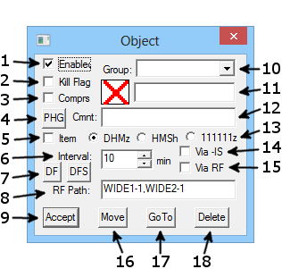

# create object

[Source wiki page](https://aprsisce.wikidot.com/createobject) · [Archived HTML](../archive/pages/createobject--5d0955bd7d6e.html) · [Source license](http://creativecommons.org/licenses/by-sa/3.0/)

**(1) Enabled**  
A tick box to enable transmission of the object

**(2) Kill Flag**  
Selecting this tick box, will send out a kill request and remove the object from all receiving stations maps.

**(3) Compress**

**(4) PHG**  
If the object is capable of transmission or reception, this button will enable you to create a PHG range circle.

**(5) Item**  
If checked, formats an APRS Item instead of an Object. However, something out there (I don't remember  
what) doesn't actually do Items, so it's probably best NOT to check this box.

**(6) Interval**  
The interval between broadcasts of the object in minutes, "net cycle time" suggests this should be between 10 and 30 minutes. (For QRU query only objects set to 0)

**(7) DF**  
Pie shaped [Direction Finding](direction-finding.md) object that originates from your specified location and expands in the specified direction.  
This direction is the bearing to the transmitter as determined by your DF equipment.  
The shape is defined by

* Bearing, Compass direction of the strongest signal heard.
* Range, which is a judgment call based on s meter readings and experience.
* Quality, How accurate is your DF equipment.

**(7) DFS**  
Places a circle around the location of your reading based on

* Strength, S Meter Units.
* HAAT, Height above AVERAGE terrain. (PHG)
* Gain, The gain of your antenna.
* Direct, Directionality of your antenna if any.

**(8) RF Path**  
sets the RF path to send the object over, defaults to the beacon path. Paths should use WIDE rather than the older trace

**(9) Accept**

**(10) Group**  
The object Group you wish the object to belong to, entering a group will add the group if it does not exist. Groups to be used for [QRU](doc-qru.md) must begin with a ?

**(11) Symbol**  
Click the symbol to bring up a box to change the object symbol

**(11) Name**  
Enter a name for the object, the more characters the better to help ensure uniqueness.

**(12) Cmnt**  
Comment that is displayed on other stations displays. This should display any important information pertaining to the object.  
Repeater objects should contain Tone information, Range, scheduled nets, or any other important information.  
A format that sticks to breaking up information by groups of 10 characters to include spaces will conform to Mobile Radio Displays

**(13) DHMz**  
7-character timestamp: day-of-the-month, hour, minute, zulu only. (Note that aprs101.pdf also provides for DHM/ for local time, but since APRS is a global initiative, APRSISCE/32 doesn't support generating this format of an object)

**(13) HMSh**  
7-character timestamp: , hour, minute, second. zulu only

**(13) 111111z**  
"Permanent" time stamp

Real-world testing has found that some radios don't like the default HMSh time format on Objects, So use either DDHHMMz or (better) 111111z. We're still not sure if all of the radios are happy with the former, but the latter seems to be the most compatible time format.

**(14) (15) Via IS/RF**  
Selects sending via RF, IS or both

**(16) Move**

**(17) Goto**

**(18) Delete**

Object creation is done via the configure/objects menu. and can also be done be right clicking a location and selecting the lat/lon option  
To create an object move the map until the location you wish to place the object is centered on the map, it very useful to have crosshairs enable for this (configure/screen/crosshairs), and zoom in as appropriate.  
When you are centered create the object via the configure/objects/create menu, you will get a popup menu. Enter a unique name, and a comment. It's useful to use all 9 characters for the name, to help ensure uniqueness. Click on the symbol, this will bring up a popup to enable selection of a symbol.  
Remember to enable and set an interval this should be roughly the same as your beacon interval.  
Select a time stamp option the default is DHMz (Day Hour Minute zulu)  
The PHG button enables the setup of Power Height Gain of the object should the object be a transmitter so that an RF range circle can be displayed. (more soon)  
The DF and DFS buttons allow the setup of direction finding objects (more soon) - See also <http://ki6psp.blogspot.com/2011/05/may-fox-hunt-in-indian-wells-valley.html>

Remember that objects should be useful for LOCAL information. Investigate your local environment to see which path is most useful to serve YOUR local area.  
Object creation can also be completed by right clicking on the screen where you wish to place an object and selecting the GPS coordinates displayed and choosing create object here.  
If you've misplaced your LAST CREATED OBJECT you can right click on the correct location, select the GPS coordinates and select Move (last object created name) here.  
DF Objects can also be created with the right click option and then following the normal directions for DF/DFS object. The theory is that were DF object shaded area's overlap is the area of your hidden transmitter(s)

some content from KC2ANT
