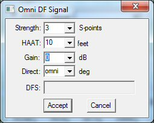
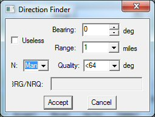

# EN_RadioDirectionFinding

[Source wiki page](https://aprsisce.wikidot.com/deleted:deleted:en-radiodirectionfinding) · [Archived HTML](../archive/pages/deleted_deleted_en-radiodirectionfinding--20886a224d9e.html) · [Source license](http://creativecommons.org/licenses/by-sa/3.0/)

|  |
| --- |
| **Radio Direction Finding** |

<table class="aprs-figure-table" style="width:100%;margin-right:auto;margin-left:auto;border:1px solid #AAA;">
<tr>
<td style="padding: 10px; text-align: left; background-color: #DDDDEE; border: 1px solid silver; width: 100%;"><strong>in progress G6UIM</strong> 
Direction finding entry is available via the configure objects menu 
Omni directional antenna direction finding entry

Strength, signal strength in S points. 
HAAT, Height above average terrain. 
Gain, Antenna gain 
Direct, estimated signal direction

Directional antenna direction finding entry

Bearing, Direction of antenna 
Range, estimated range of signal 
N: ? 
Quality: ?

</td>
</tr>
</table>

|  |
| --- |
|  |
