# DF Example

[Source wiki page](https://aprsisce.wikidot.com/dfexample) · [Archived HTML](../archive/pages/dfexample--c9d68bef511f.html) · [Source license](http://creativecommons.org/licenses/by-sa/3.0/)

Radio Direction Finding is an exercise that makes use of directional antennas in an attempt to track down the source of a radio signal. Multiple bearings taken from disparate vantage points can provide a set of triangulated bearings that will narrow down a search area such that the signal source can be found. It is possible for multiple receiving stations to work cooperatively to find the signal source, such as searching for a stuck transmitter, jammer, tracking down a lost hiker, or a downed aircraft.

Some people conduct exercises where a station deliberately hides, and sends periodic transmissions for teams of hunters to track down. Tracking teams work individually in an effort to be the first to find the hidden transmitter. Scoring may be based solely on elapsed time, or on accumulated mileage, a combination of both, or other criteria.

Below is a description of a hunt that took place in January of 2010 in Edmonton, Alberta. At that time APRSISCE/32 did not support DF Reports, so RadioMobile was used as a tool to plot directional sectors. Since that time, APRSISCE/32 has had DF sector support included. Images on the left are from RadioMobile, where the images on the right are from APRSISCE/32.

**Note: Clicking on an image may bring up a bigger version to see more easily.**

|  |  |  |
| --- | --- | --- |
| [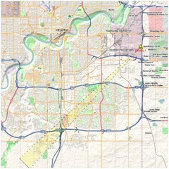](../archive/assets/local--files_dfexample_DF1--4be2e4859375.png) | The first bearing was taken from the Northern Alberta Radio Club repeater site. This site has an excellent height above the city, and can give a very clean and reliable first directional. This bearing was nice and strong, and very clean, indicating southwest . Since the only route out of the NARC site is to the west, the decision was made to travel south on 17th street towards Anthony Henday Drive.    VE6SRV>APWW10:;SRV.DF.1 \*231105/5331.49N/11320.81W\000/000/226/946 | [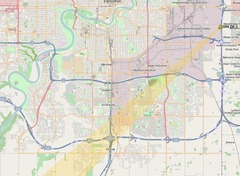](../archive/assets/local--files_dfexample_ADF1--25695d4fffaf.png) |
| [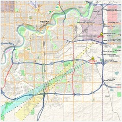](../archive/assets/local--files_dfexample_DF2--cd3508138eef.png) | A second bearing was taken just north of Whitemud Drive, a major east/west freeway. This bearing was used to get a cross bearing on the fox. While the heading didn’t change much, and still left a large area of overlap, it did confirm that the target area was still south of the Whitemud. The decision made was to continue travelling south towards the Anthony Henday ring road.    VE6SRV>APWW10:;SRV.DF.2 \*231300/5329.39N/11322.14W\000/000/242/946 | [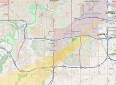](../archive/assets/local--files_dfexample_ADF2--8e47d09ac838.png) |
| [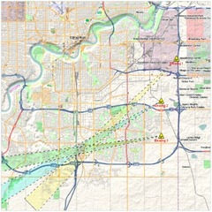](../archive/assets/local--files_dfexample_DF3--f6fb80423175.png) | A third bearing was taken just north of 23rd Avenue. This bearing gave a better cross bearing, and narrowed the potential search area. This also confirmed the selection of Anthony Henday as an access route to the search area.    VE6SRV>APWW10:;SRV.DF.3 \*231425/5327.36N/11322.14W\000/000/262/946 | [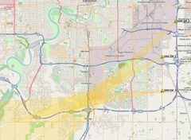](../archive/assets/local--files_dfexample_ADF3--838c71b82a3a.png) |
| [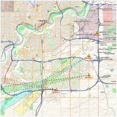](../archive/assets/local--files_dfexample_DF4--bc97ebd859de.png) | The fourth bearing was taken from just before the 91 St off ramp. This location was chosen so that if the bearing was diverging from the Anthony Henday, then a new route could be chosen. The heading observed was slightly north of west. Whether this bearing was influenced by physical characteristics in the area or by psychological factors is unknown. I had the idea in my mind that the fox was near the intersection of Calgary Trail and Anthony Henday. This may have tainted what I perceived as the directional bearing.    VE6SRV>APWW10:;SRV.DF.4 \*231822/5326.20N/11327.18W\000/000/278/937 |  |
| [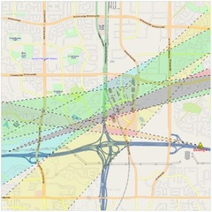](../archive/assets/local--files_dfexample_DF5--d094636df267.png) | Here’s a closer look at the area of interest. You can see that the fourth bearing does not correspond with the other bearings taken previously. Long range bearings can be less accurate, so the latest bearing was assumed to be more accurate. Sometimes however you get thrown a red herring. One has to weigh the merits of each bearing, and be prepared to ignore possible tainted data. | [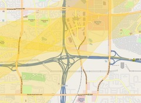](../archive/assets/local--files_dfexample_ADF5--db790aa71867.png) |
| [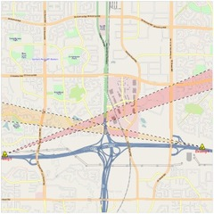](../archive/assets/local--files_dfexample_DF6--33a76c05d0d7.png) | The fifth bearing was taken just before the 119th Street turn off, as the next opportunity to exit the Anthony Henday was nearly 3 miles ahead. This bearing was found to point back to the east, indicating that the hidden transmitter location had been overshot. The bearing indicating slightly north of east lead me to focus on South Edmonton Common (A major shopping center, the pink background area on the map) as a potential target area. All previous bearings have been cleared to enable easier visualization of the latest higher accuracy bearings. We know the hidden transmitter will be within the area of probability defined by the previous long range bearings.\_  \_  VE6SRV>APWW10:;SRV.DF.5 \*232043/5326.11N/11331.92W\000/000/065/927 | [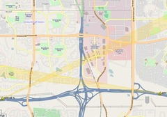](../archive/assets/local--files_dfexample_ADF6--08add86a0b90.png) |
| [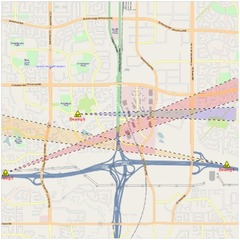](../archive/assets/local--files_dfexample_DF7--200e75f3abf3.png) | The sixth bearing was taken from an area close to the suspected target area, in order to determine whether the hidden transmitter was east or west of Calgary Trail. Bearing combined with signal strength information indicated that the hidden transmitter was most likely in South Edmonton Common.    VE6SRV>APWW10:;SRV.DF.6 \*231227/5326.90N/11330.74W\000/000/090/927 |  |
| [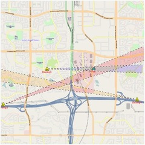](../archive/assets/local--files_dfexample_DF8--b845205a83a9.png) | The seventh bearing was to be taken from just east of South Edmonton Common in order to ensure that the hidden transmitter was indeed in the common, as well as to determine which section of the common to search. It was at this point that the hidden transmitter was found. Sometimes you just get lucky! I selected a spot just east of South Edmonton Common as a location to take a directional, and as I got out of the vehicle to swing the beam, the suspect vehicle was spotted. Looking at this now, I can see that this was a bad decision, as I should have set up to get a directional that would have been perpendicular to the sixth bearing.    VE6SRV>APWW10:;FOX \*231312/5326.87N/11328.79W>Hidden Transmitter | [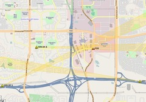](../archive/assets/local--files_dfexample_ADF8--44ba58478009.png) |

Exact bearing information from RadioMobile was not available when the APRSISCE/32 images were created, so approximate locations, bearings, and NRQ data was used to provide the APRSISCE/32 screen shots. As such there are minor discrepancies in the DF sectors presented in each image.
