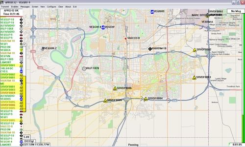
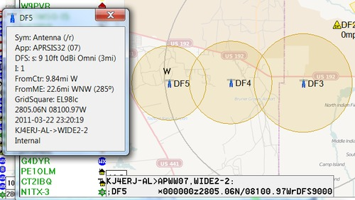
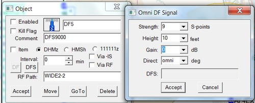
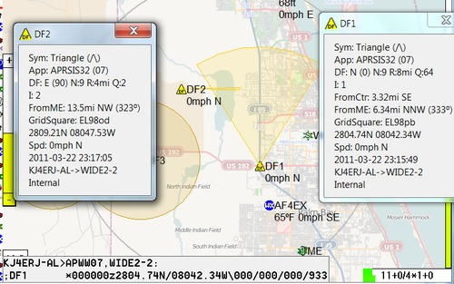
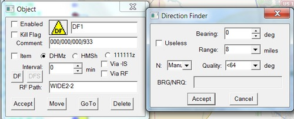

# Direction Finding

Direction Finding is the process of using the signal strength of a received signal to pin-point the location of the source of the transmitted signal. The process can be as simple as using reception (and non-reception) reports from various locations (or stations), and plotting circles on a map that correspond to the approximate area that the characteristics of the receiving station would allow it to hear a signal. By plotting enough reception reports, an overlapping area where all the stations can hear the specific signal should indicate an area of high probability for the location of the transmitter.

The use of a high gain directional antenna can allow for more accurate reception reports, narrowing down the area of interest by plotting a "directional" from the receiving station towards the apparent signal source. Directional signal reports have a number of variables that can affect the accuracy of the directional. The beamwidth of the directional antenna must be taken into account, as well as the quality of the directional, along with the strength of the received signal. Other types of direction finding antennas can also be used to determine the direction towards the strongest signal, such as Time Difference of Arrival (TDoA) arrays, or Dopper Arrays. Some of these devices can automatically determine the heading towards the signal source, and produce a serial data stream for input into appropriate software for automatic DF reports.

APRSISCE/32 supports the standard APRS DF reporting formats as defined in the APRS101 document. Omnidirectional signal strength reports where a simple reading of signal strength with no regard for the direction that the signal is coming from is supported by the DFS report. Direction finding sectors where an azimuth providing a direction towards the signal source, as well as some quantitative data about the directional observed is supported using the DF report format.

## DFS Report

The Omni DF Signal Strength report is requires the least amount of information from the reporting station. All that is needed to be known is some basic information about the station, and the strength of the signal observed. The location of the station making the observation must be known, as well as a little basic information on the antenna, both antenna height, and antenna gain and if applicable, a direction favoured by the station.

Upon reception of a DFS report, a circle is drawn around the reported location. The size of the circle is based upon the antenna height and gain of the reporting station, and signal strength information provided in the report. The higher the antenna, and the higher the gain, the larger the circle will be, which represents the area which can be heard by the station. The stronger the signal strength reported, the smaller the circle, based upon free space loss. A very strong signal will be closer than a weak signal. Of course, the output power of the unknown station will factor in, but that is an unknown quantity that can not be reported by a observer.

A signal strength report of zero indicates non-reception of the signal. Non-reception reports may appear to be useless information, but to the contrary, areas where the transmitter can not be heard narrow the search area significantly. Areas reporting a zero signal strength are plotted with a dark grey shading to indicate non-reception.

#### Sending a DFS report with APRSISCE/32

APRSISCE/32 allows the input of this information through an input dialog. The input dialog can be found by creating an object on the map, and then selecting the DFS button on the create object dialog. You can then select the four variables from the pull down selectors to configure the desired DFS report.

You can select whether the DFS report stays on the local machine, or is sent out via RF, IS, or both via the provided dialog window. The directivity option allows you to select a favoured direction, and skews the DFS circle towards the favoured direction. This can be used where local terrain or other obstructions cause distortions to the reception pattern of the local station.

## DF Report

The DF Report provides a higher precision reception report than the Omni DF Signal Strength report. A DF Report provides bearing information that indicates the direction from the reception station towards the signal source. Further information included provides data about the confidence of the report, distance, and quality of the bearing provided.

The DF report will contain location information that describes the location of the observing station, including course and speed of the observing station. If the observing station is a fixed station, the course/speed is reported as 000/000. For a mobile station, the course is significant as the bearing reported will be relative to the direction the vehicle is headed. Course and bearing information is combined to produce the true heading to the signal source.

The DF report contains four significant pieces of information in the APRS data extension portion of the packet: CSE/SPD/BRG/NRQ. CSE and SPD provide information about the course and speed of the observing station. BRG indicates the RAW bearing from the observing station to the signal source. The last value in the data extension is the NRQ value, which can be broken down into Number/Range/Quality.

The Number portion describes the "Number of Hits", or confidence of the data. An N value of zero indicates that the DF report is useless. An N value of 9 indicates that they DF report is a report manually entered by a human. A value from 1 to 8 is used by automated reporting equipment to indicate the relative number of hits that contributed to the data produced. A value of 8 indicates that 100% of the samples taken matched the bearing reported, while a value of 1 indicates that very few of the samples collected concur with the bearing reported.

The Range portion describes the scale of the map used to produce the DF report. Map scale can be gleaned from a manually produced DF report when a user clicks on points on the map, but automated DF reports may be produced with the screen resolution at any scale.

The Quality portion describes the accuracy of the bearing being reported. Bearing accuracy is affected by many factors including but not limited to antenna beamwidth, multipath reflections, local obstructions, and interference. A Q value of 0 indicates a useless bearing, while a Q value of 9 indicates a bearing accuracy of greater than 1°.

#### Sending a DF Report with APRSISCE/32

APRSISCE/32 allows you to create a DF report bearing in a couple ways. One allows you to simply click on a location on the map, and have the bearing automatically calculated from the center of the screen to the location clicked. This is handy when mobile if you have the map centered on your current location. You can use a local landmark as a bearing reference, and then select that landmark on the map.

To create a DF report in this manner, right click on the screen at the desired location, and select the lat/long pulldown, then Create New DF @ Center, then choose your desired accuracy factor. An Object dialog will pop up where you can modify the properties of the DF report, and the delivery method. If you click on the DF button, you can manually adjust the BRG and NRQ values as desired.

Alternately you can right click on any location on the map, and select the lat/long pulldown, then select New DF Here. The Object dialog will pop up, and you will have to click on DF and edit the bearing and NRQ information to reflect your desired information. This second method is handy to use if receiving DF reports from others that do not have APRSISCE/32. You can click on the map at the location they describe to you, and then manually enter the BRG/NRQ information they provide.

[Direction Finding Example](dfexample.md)
