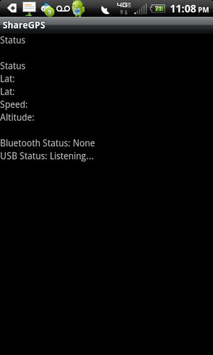
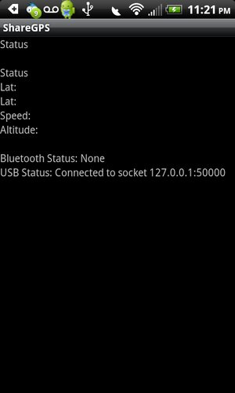

# How to use the Android Smartphones GPS With APRSISCE/32

[Source wiki page](https://aprsisce.wikidot.com/doc:android) · [Archived HTML](../archive/pages/doc_android--b44af355f0a2.html) · [Source license](http://creativecommons.org/licenses/by-sa/3.0/)

# **NOTE: APRSISCE/32 DOES NOT RUN ON ANDROID!**

This howto is to show you how to use the gps on your android device and link it to a laptop running windows (XP/Vista/Win7) and APRSISCE/32

Download and install "ShareGPS" from the android market. [ShareGPS Market Link](https://market.android.com/details?id=com.jillybunch.shareGPS&hl=en)

Unless you have it already, download and install the [Android SDK](http://developer.android.com/sdk/index.html)

Follow the instructions on the SDK website to install the ADB server tools and if needed the USB driver.

Once everything is installed, go into the settings for ShareGPS, disable the bluetooth, and enable the USB connection.

On the phone's display, it should show "USB Listening" as shown on the screenshot below:

Also while you are in the settings, you need to change the format of the co-ordinates to "deg:min:sec" as I found that works better with aprsisce/32

Now on the PC that's connected via USB, fnd where your adb.exe file is located with windows explorer, and right click->"send to desktop". This will create a shortcut on your desktop to the ADB program.

Then goto the desktop and you should see "Shortcut to adb.exe". on that shortcut, right cliek and go into the properties tab. Under the "target" box, you should see something similar to this:

**C:\Android\android-sdk\platform-tools\adb.exe**

what you need to do is enclose that line in double quotes so it looks similar to this:  
"C:\Android\android-sdk\platform-tools\adb.exe"

now you need to add the following to the end of the target line

**forward tcp:50000 tcp:50000**

such that it looks something like this:

**"C:\Android\android-sdk\platform-tools\adb.exe" forward tcp:50000 tcp:50000**

now click the "general" tab and rename it to something like:

**ADB Forward GPS**

then click OK. What this basically does is forward the port that ShareGPS uses on the android device to the local machine.

# Setup APRSISCE/32

Configure / Ports / NMEA and select TCPIP the first time. If you've already configured a Serial (COMn) or  
Bluetooth port, you'll need to go into that configuration and blank it out (select empty things from the  
drop-downs) and then go back into Configure / Ports / NMEA to get the type selection.  
Once you configure a TCP/IP address and port, APRSISCE/32 will connect to that port and expect to receive  
<cr><lf> delimited raw NMEA strings from a GPS. Nothing will be sent to that device which makes error detection  
and automatic reconnection rather problematic.

now if you look at the ShareGPS screen on the android device, under the USB Status line you should see something similar to  
**"Connected to socket 127.0.0.1:50000"**

if you turn on the nmea port logs in aprsisce/32 you should start to see nmea sentences coming from the phone,

if not, then in sharegps you may need to turn on "create nmea". I didnt need to do this.

# CAVEATS:

If your phone becomes unplugged from the pc for whatever reason, you will need to re-run your adb forward  
shortcut, on my laptop for example, i've had pdanet and sharegps running along with "gps status" but every now  
and again, I've found that the phone will disconnect from the usb port for no reason. I think this is a  
thunderbolt specific bug but I will check that out on my eris too (When i can find out where it is :P)
