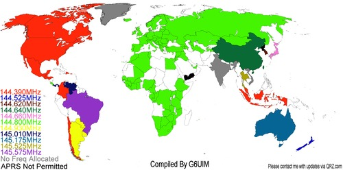
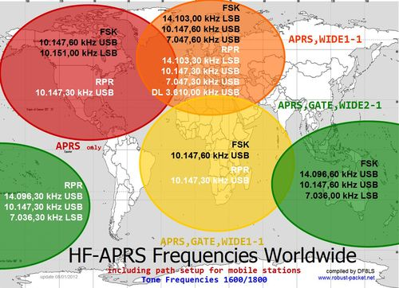

# Frequencies

[Source wiki page](https://aprsisce.wikidot.com/doc:frequencies) · [Archived HTML](../archive/pages/doc_frequencies--d46714a3e362.html) · [Source license](http://creativecommons.org/licenses/by-sa/3.0/)

|  |
| --- |
| **Frequencies** |

<table class="aprs-figure-table" style="width:100%;margin-right:auto;margin-left:auto;border:1px solid #AAA;">
<tr>
<td style="padding: 10px; text-align: left; background-color: #DDDDEE; border: 1px solid silver; width: 100%;"><strong>VHF</strong> 
United States, Canada, Chile, Indonesia, Singapore, Malaysia, Mexico, Dominican Republic, Puerto Rico, Trinidad &amp; Tabago, Columbia: 144.390 MHz 
Europe, UK, Ireland, Iceland, Russia, South Africa, Azores, Costa Rica, Israel, Lebanon, Senegal: 144.800 MHz 
Australia, Tasmania: 145.175 MHz 
New Zealand: 144.575 MHz 
Argentina, Uruguay, Paraguay: 144.930 MHz 
Japan: 144.640 MHz 9600 baud 
China, Hong Kong, Taiwan: 144.640 MHz 
South Korea: 144.620 MHz 
Japan: 144.660MHz 1200 baud 
Thailand: 145.525 MHz 
Brazil: 145.570 Mhz 
North Korea, Yemen: Amateur Radio not Permitted 
<strong>UHF</strong> 
Europe: Primary 433.800 MHz Secondary 432.500 MHz 
Australia: 439.100 MHz 1200 baud 
Netherlands: 430.5125 MHz 1200 baud 
US Nationwide Proposed: 445.925 
New Zealand: 432.575 MHz 1200 baud

<strong>HF</strong> 
USB Dial Frequency Mark Frequency LSB Dial Frequency 
KAM, MFJ, TinyTrak 10.147.600 MHz 10.149.200 MHz 10.151.000 MHz 
AEA 10.147.100 MHz 10.149.200 MHz 10.151.500 MHz 
RPR ( Robust Packet Radio) 14.103,300 MHz LSB - 10.147,300 MHz USB - 7.047,300 MHz USB - 3.610,000 MHz USB (uniform dial frequencies) 
NET14 14.103 LSB

<strong>Satellites</strong> 
ISS up 145.825MHz down 145.825MHz Path ARISS or RS0ISS-4 
PCSat (NO-44) up 145.825MHz down 145.825MHz Path ARISS or W3ADO-1

<strong>VHF Frequency Map</strong> (Click for full size)

<strong>HF Frequencies</strong> 
North America (red) Main activities take place on the 30 m band. No further information could be found so far concerning the other bands. According to WA8LMF the density of gates in North America is such high that digipeating is undesirable. A point of view that can be found in Europe as well. Anyway we have to keep on mind that i.e. mobile stations with a distance of 100-200 km to each other would never learn their proximity. With flat tires in the middle of nowhere digipeating then gets a different touch… 
When RPR traffic starts now in North America a path APRS,WIDE1-1 is recommended. FSK (HFP) traffic does not encounter any influence by RPR ! Europe (orange) – see comment on previous page Africa (yellow) Only activities observed are on the 30 m band. It is known that RPR gates are offered as well. Whether that is upon request and therefore temporary only is matter of survey. 
Oceania (green) – Driving force when it comes to HF-APRS are the Australian hams. Specifics here are the different frequencies on 20 m &amp; 40 m compared to Europe and different side band selection as well. The historical developement doing HF-APRS came by the usage of old commercial radios. Those provided only USB and so 20 m was kept USB ever since. Shown RPR Frequencies are theoretical entries only for the time being but hams down there are highly interested to enter the community of robust packet users. 
General statement about path setting in South Africa and Australia – In those areas gating to the internet takes place via crossgating to the VHF-net. So by using GATE and then WIDEN-n results in the nessecary hops to the VHF IGATE

<strong>HF Frequency Map</strong> (Click for full size)

</td>
</tr>
</table>

|  |
| --- |
|  |
