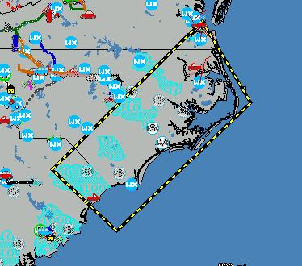
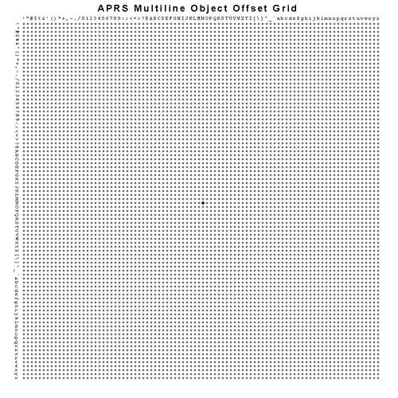

# Multiline Object Definition

[Source wiki page](https://aprsisce.wikidot.com/doc:multiline) · [Archived HTML](../archive/pages/doc_multiline--552ff9fddf1e.html) · [Source license](http://creativecommons.org/licenses/by-sa/3.0/)

|  |
| --- |
| **Multiline Object Definition** |

<table class="aprs-figure-table" style="width:100%;margin-right:auto;margin-left:auto;border:1px solid #AAA;">
<tr>
<td style="padding: 10px; text-align: left; background-color: #DDDDEE; border: 1px solid silver; width: 100%;">The APRS protocol defined support for reporting National Weather Service bulletins. This was fine for putting a text bulletin that would give a description of the warning, but APRS is about being able to map out things in a graphic fashion.

APRS has the ability to create area objects, but the area objects are limited to lines, boxes, circles, triangles, and ellipses.

NWS alert areas rarely nicely fit into the above defined shapes, thus the multiline definition was born.

The APRS multiline object definition is based on an APRS object, which is one of the basic building blocks of APRS. The multiline portion of the definition is encoded into the comment of the object.

<h2 id="toc0">Multiline Definition</h2>

The comment definition has a specific format that needs to be followed.

The definition starts with a &lt;space&gt; character. 
The next character must be "}" which specifies that a multiline object definition follows. 
The third character defines the type of line (solid, dashed, double dashed), and colour (red, blue, yellow, green). 
The fourth character defines the object type (line or area). 
The fifth character defines the scale of the object. 
Next come pairs of characters that define the location of each vertex of the definition. There can be up to 23 pairs of location definitions in the comment. 
The end of the location pairs is defined by "{". 
The final portion of the definition is a 5 alphanumeric character identifier.

<h2 id="toc1">Sample Multiline Object</h2>

The image below shows a multiline object which is defining an area of concern for a severe thunderstorm in the Carolinas.

The following is the APRS object packet which defined the above watch area:

;SPCS1528z*262100z3500.00NS07730.00WWSvr TStormWatch #174 }e0]FgcBS6:W{QFSAA

<table class="wiki-content-table">
<tr>
<td>;</td>
<td>object name</td>
<td>_</td>
<td>time</td>
<td>lat</td>
<td>sym table</td>
<td>long</td>
<td>sym code</td>
<td>comment</td>
<td>multiline</td>
<td>line type</td>
<td>object type</td>
<td>scale</td>
<td>lat long pairs</td>
<td>end &amp; identifier</td>
</tr>
<tr>
<td>;</td>
<td>SPCS1528z</td>
<td>*</td>
<td>262100z</td>
<td>3500.00N</td>
<td>S</td>
<td>07730.00W</td>
<td>W</td>
<td>Svr TStormWatch #174</td>
<td>_}</td>
<td>e</td>
<td>0</td>
<td>]</td>
<td>FgcBS6:W</td>
<td>{QFSAA</td>
</tr>
</table>
<h3 id="toc2">Multiline Definition Start</h3>

The multiline defintion starts with a &lt;space&gt; character followed by a right curly brace " }".

<h3 id="toc3">Multiline Line Types</h3>

The multiline definition includes 4 colours, and 3 line types for a total of 12 defined types.

<table class="wiki-content-table">
<tr>
<td>Character</td>
<td>Colour</td>
<td>Line Type</td>
<td>Use in NWS Mesages</td>
</tr>
<tr>
<td>a</td>
<td>red</td>
<td>solid</td>
<td>Tornado Warning</td>
</tr>
<tr>
<td>b</td>
<td>red</td>
<td>dashed</td>
<td>Tornado Watch</td>
</tr>
<tr>
<td>c</td>
<td>red</td>
<td>double dashed</td>
<td></td>
</tr>
<tr>
<td>d</td>
<td>yellow</td>
<td>solid</td>
<td>Severe Thunderstorm Warning</td>
</tr>
<tr>
<td>e</td>
<td>yellow</td>
<td>dashed</td>
<td>Severe Thunderstorm Watch</td>
</tr>
<tr>
<td>f</td>
<td>yellow</td>
<td>double dashed</td>
<td></td>
</tr>
<tr>
<td>g</td>
<td>blue</td>
<td>solid</td>
<td>Test Warning</td>
</tr>
<tr>
<td>h</td>
<td>blue</td>
<td>dashed</td>
<td>Test Watch</td>
</tr>
<tr>
<td>i</td>
<td>blue</td>
<td>double dashed</td>
<td></td>
</tr>
<tr>
<td>j</td>
<td>green</td>
<td>solid</td>
<td></td>
</tr>
<tr>
<td>k</td>
<td>green</td>
<td>dashed</td>
<td>Mesoscale Discussion Areas</td>
</tr>
<tr>
<td>l</td>
<td>green</td>
<td>double dashed</td>
<td></td>
</tr>
</table>
<h3 id="toc4">Multiline Object Type</h3>

There are currently only 2 object types defined.

<table class="wiki-content-table">
<tr>
<td>Character</td>
<td>Object Type</td>
</tr>
<tr>
<td>0</td>
<td>Closed Polygon</td>
</tr>
<tr>
<td>1</td>
<td>Line Segment</td>
</tr>
</table>
<h3 id="toc5">Multiline Scale</h3>

The scale character is a single character that defines the overall scale of the grid. It defines the distance between each of the point in the grid. The math behind the scale is based upon 1/1000th of a degree multiplied by log base 10 of the scale factor multiplied by 20. This number is then added to 33 to get into a printable character. It sounds a lot more complicated than it is…

(20 * (0.0001 * log (scale))+33 = scale character

This allows for many variable scales, below are some decimal degree scale factors.

<table class="wiki-content-table">
<tr>
<td>Scale Character</td>
<td>Resolution (deg)</td>
<td>Resolution (km)</td>
<td>Area covered (deg)</td>
<td>Area Covered (km)</td>
</tr>
<tr>
<td>!</td>
<td>0.0001</td>
<td>0.011</td>
<td>0.009</td>
<td>1.00</td>
</tr>
<tr>
<td>5</td>
<td>0.001</td>
<td>0.111</td>
<td>0.09</td>
<td>10.01</td>
</tr>
<tr>
<td>I</td>
<td>0.01</td>
<td>1.113</td>
<td>0.9</td>
<td>100.19</td>
</tr>
<tr>
<td>]</td>
<td>0.1</td>
<td>11.132</td>
<td>9</td>
<td>1001.92</td>
</tr>
<tr>
<td>q</td>
<td>1</td>
<td>111.325</td>
<td>90</td>
<td>10019.25</td>
</tr>
</table>
<ul>
<li>Be aware that the distance per (latitude) degree is accurate at the equator, as you move closer to the poles, the distance decreases, making your grid rectangular, not square.</li>
</ul>

To get the most resolution for defining your multiline object, you want to keep the scale as small as possible. Choose a scale factor that just encompasses the full extent of the area to be defined.

<h3 id="toc6">Multiline Grid</h3>

The offset character pairs are based on a grid as below. The first character defines the latitude offset, the second character defines the longitude offset from the base object defined. There are 45 points left or above, and 44 points right or below the reference point defined by the object. The image below can give you an idea of how the offset characters work towards defining where the vertices of your line/area exist.

<h3 id="toc7">End Character and Identifier</h3>

The end of the vertex definitions is denoted by the { character and is immediately followed by a 5 character identifier. The identifier can be used to confirm that the multiline definition is real, and not just random garbage from packet collisions or other sources.

<h2 id="toc8">Multiline Creation in APRSISCE/32</h2>

APRSISCE/32 now has a rudimentary multiline object creation capability built in. Follow the procedure below to create your own tracked objects and convert them to a MultiLine object.

<ol>
<li>Right click at one end of your line or one point on your area. From the Coordinate cascade, select "Create Object HERE" and give it a name and comment. You'll need to keep it Enabled, but you do not need to check any of the Vias. The screen should center and lock on your new object.</li>
<li>Drag and pan to the next point along your line or area. Again, right click, but this time select "Move &lt;ObjName&gt; HERE" from the coordinates cascade.</li>
<li>Repeat step 2 as many times as necessary to build up the line or area boundary using the tracks you're making with the object. I don't enforce the 23 limit yet, so please don't say it's broken if it breaks.</li>
<li>If you don't like the most recent point you added, you can left (normal) click on the object itself and select "Shrink Track" from the new "My Object" cascade. After confirming, the object track will have the most recent point removed.</li>
<li>When you have all of the line segments tracked, or are one step from closing your area, left (normal) click on the object name itself. From the new "My Object" cascade, select "Track to Area" or "Track to MultiLine".</li>
</ol>

When APRSISCE/32 creates the Multiline object, it takes into account the distance to the most distant offset, and uses that to determine the scale required, and then attempts to find the best fit for each vertex defined.

Now you can compare your object's track with the line or area boundary that you got. Expect LOTS of error depending on the size of your 
maximum offset. Also, since MultiLine objects are relative the object position, don't be surprised to see the line or shape move intact if you 
decide to start over with the same object!

</td>
</tr>
</table>

|  |
| --- |
|  |
