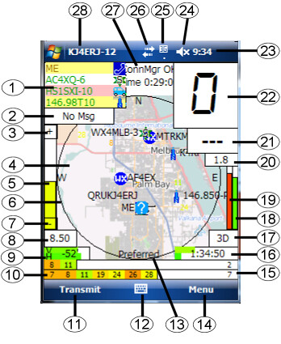
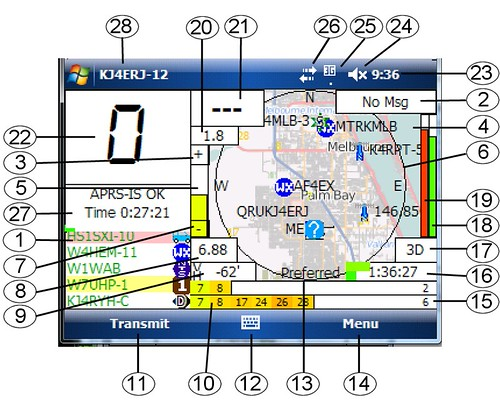

# Screen Elements

[Source wiki page](https://aprsisce.wikidot.com/doc:screen-elements) · [Archived HTML](../archive/pages/doc_screen-elements--0aa4d1978d4a.html) · [Source license](http://creativecommons.org/licenses/by-sa/3.0/)

|  |
| --- |
| **Screen Elements** |

<table class="aprs-figure-table" style="width:100%;margin-right:auto;margin-left:auto;border:1px solid #AAA;">
<tr>
<td style="padding: 10px; text-align: left; background-color: #DDDDEE; border: 1px solid silver; width: 100%;">

1 <a href="scroller.md">Scroller</a> 
2 <a href="message-notifier.md">Message Notifier</a> 
3 <a href="zoom-bar.md">Zoom in</a> 
4 <a href="map-display.md">Map Display</a> 
5 <a href="zoom-bar.md">Zoom Bar</a> 
6 <a href="map-display.md">Range Circle</a> 
7 <a href="zoom-bar.md">Zoom out</a> 
8 <a href="map-display.md">Range Value</a> 
9 <a href="gps.md">GPS Precision and Altitude</a> 
10 <a href="gps.md">GPS Satellite signal level</a> 
11 Transmit (Windows Mobile User Interface) 
12 Keyboard (Windows Mobile User Interface) 
13 <a href="map-display.md">Display type</a> 
14 Menu (Windows Mobile User Interface) 
15 <a href="gps.md">Number of Satellites</a> 
16 <a href="gps.md">Time/Date</a> 
17 <a href="gps.md">GPS Fix Type</a> 
18 <a href="battery.md">Battery Status</a> 
19 <a class="newpage" href="https://aprsisce.wikidot.com/stations">Station Count</a> 
20 <a class="newpage" href="https://aprsisce.wikidot.com/odometer">Odometer</a> 
21 <a href="gps.md">Heading</a> 
22 <a href="gps.md">Speed</a> 
23 Time (Windows Mobile User Interface) 
24 Volume (Windows Mobile User Interface) 
25 Cellular Connection (Windows Mobile User Interface) 
26 Data transfer (Windows Mobile User Interface) 
27 <a class="newpage" href="https://aprsisce.wikidot.com/connections">Connection Status</a> 
28 Callsign (Windows Mobile User Interface) 
29 Overhead Satellite Position (not annotated above). Look for faint colored numbers within the range circle, these are the satellites overhead.

</td>
</tr>
</table>

|  |
| --- |
|  |
