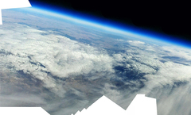
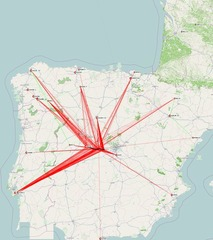

# EN_Ballooning

[Source wiki page](https://aprsisce.wikidot.com/en-ballooning) · [Archived HTML](../archive/pages/en-ballooning--dd25bff8f5fd.html) · [Source license](http://creativecommons.org/licenses/by-sa/3.0/)

|  |
| --- |
| **Ballooning** |

<table class="aprs-figure-table" style="width:100%;margin-right:auto;margin-left:auto;border:1px solid #AAA;">
<tr>
<td style="padding: 10px; text-align: left; background-color: #DDDDEE; border: 1px solid silver; width: 100%;"><strong>Using APRSISCE/32 for Balloon tracking</strong> With advice on path settings 
The following composite image was taken above Spain and Portugal during the PARIS flight (click for larger image)

This thumbnail shows why it's a bad idea to run paths at altitude, I hit lots of Igates in two countries, imagine all the digipeaters I hit as well (click to enlarge)

APRSISCE/32 contains two features added to aid balloon tracking, Communication <a href="doc-alt-range.md">Range footprint</a> this uses a simplified formula to calculate the range of a line of site signal. 
Distance [miles] = 1.23 * SQRT(Altitude [feet]) this formula assumes the earth is a sphere, and takes no account of any obstacles between you and the balloon. But in practice works well enough to work out if you are within range of the balloon. 
also available is the ability to change the color of the track, depending on altitude and to save the flight in a GPX file

Configure the range circles under configure=&gt; Screen-&gt; Labels-&gt; Footprint 
and set the mimimum and maximum altitude any station above the minimum altitude will then show with a range circle if you also enable Screen-&gt; labels-&gt; footprint 
once you have an object showing on screen left click the object and you have the option to enable color track, and also to save a GPX file of the track for future use. 
You can at a later date select to drive the track for viewing 
Coming soon 
Watch this space &gt; &lt; 
G6UIM

</td>
</tr>
</table>

|  |
| --- |
|  |
