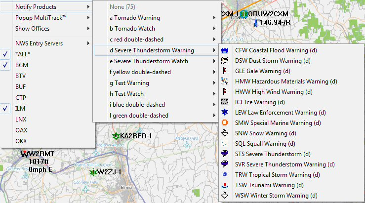
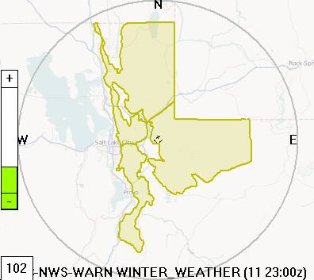

# EN_NWS

## National Weather Service

**National Weather Service Setup for APRSIS32**  
The US National Weather Service (NWS) puts out information that can be displayed on your APRSIS32 display. This information includes Severe weather warnings. First thing you need to know, is which NWS office you want to display information from.  
[Forecast\_Offices](http://en.wikipedia.org/wiki/List_of_National_Weather_Service_Weather_Forecast_Offices)  
Is one resource website for finding the office abbreviation. The other thing that you will need to do is Download the NWS shape files from [US NWS](http://www.nws.noaa.gov/geodata/) or for Australian offices [Here](http://wxsvr.aprs.net.au/shapefiles-new.html) There are a lot of them, and it depends on what you want to see for which ones you download. **(Do Not use files dated in the future, but do check regularly for updates)**

**Configure->NWS Shapefiles**  
Once you have the files downloaded, you have to point the program to them.

Add each individual file using the add file menu, and enable them by making sure each file has a tick next to it and enabled is also ticked. Set your display settings.

**Configure->NWS->**  
**New Office->** Enter NWS Office to Monitor

In this box, you enter the 3 letter abbreviation for the office you want to receive alerts from [Forecast\_Offices](http://en.wikipedia.org/wiki/List_of_National_Weather_Service_Weather_Forecast_Offices)  
If you enter “\*” into this box, you will get alerts from ALL NWS offices. This is a lot of information, especially during storm seasons. Make sure that your PC and internet connection will support this much information.

**Messages->** This is a check box for receiving messages containing NWS information. If you want to see what creates the shapefiles then check this, if you can’t read programming language, then you might want to leave this unchecked.  
**Message NOT all->** This is for messages that are not directed to ALL stations  
**Messages Notify->** Do you want to be notified of these messages  
**Notify Line Type->** What line types do you want to see on your screen.

Default is all checked.  
**Notify Products->** This determines which weather Icons you want to be notified of

Default is all enabled.  
**Notify Multitrack->** Under what circumstances do you want a multitrack window to pop up

Multitracks are memory intensive, be sure that you want to see what you check. Strongly suggested that the windows close when the warning they display expires.  
**Show Offices->** This will highlight the office coverage area on your main display. If you have more than one office selected, it will overlap.

**NWS Entry Servers->** what servers do you want to receive data from

This will auto check servers. Notice the Australian server. If you don’t care about the weather, make sure you uncheck it.  
Under that will be a list of configured NWS offices, the checked ones are the ones you will display information for. Again, make sure that your PC and Internet connection can support the data that you’re requesting. If the program locks up shortly after configuring NWS offices, you should think about reducing the number of offices you display.  
**Example NWS alerts**

Good luck,  
Adam KC2ANT First version 11/6/12
