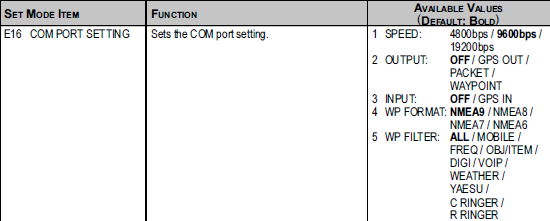
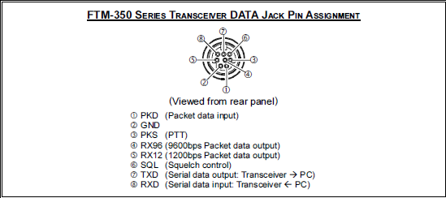
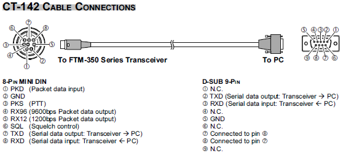

# FTM350

[Source wiki page](https://aprsisce.wikidot.com/ftm350) · [Archived HTML](../archive/pages/ftm350--b1e08b094991.html) · [Source license](http://creativecommons.org/licenses/by-sa/3.0/)

|  |
| --- |
| **FTM350** |

<table class="aprs-figure-table" style="width:100%;margin-right:auto;margin-left:auto;border:1px solid #AAA;">
<tr>
<td style="padding: 10px; text-align: left; background-color: #DDDDEE; border: 1px solid silver; width: 100%;">The FTM-350 is supported by APRSISCE/32 with a Port Type of FTM350v1.3(RO) provided you have firmware version 1.3 loaded. This creates a receive only port as Yaesu doesn't (yet as of 1.3 firmware) support transmitting from computer control. Yaesu <em>may</em> at some point support a bi-directional packet radio port, but at this time, receive only is supported. You will be able to see the locations of stations being received by the radio, but will not be able to send packets from APRSISCE/32 to RF.

The E16 menu (v1.3 firmware) needs to be configured to enable packet output on the FTM-350AR. Set menu option E16's OUTPUT to PACKET for the raw APRS packets to be delivered out the serial port of the FTM-350AR.

The Yaesu FTM-350AR manual contains the pinout information for the radio's data port.

Yaesu also sells a ready made cable that can be used to connect the radio to your computer's serial port, called the CT-142.

</td>
</tr>
</table>

|  |
| --- |
|  |
