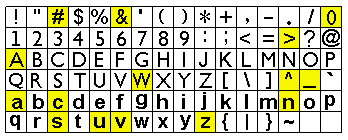
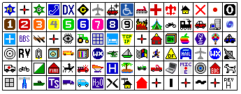
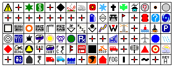
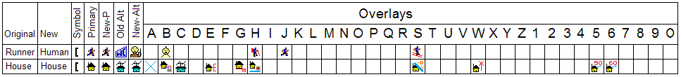

# futuresym

[Source wiki page](https://aprsisce.wikidot.com/futuresym) · [Archived HTML](../archive/pages/futuresym--441fce023254.html) · [Source license](http://creativecommons.org/licenses/by-sa/3.0/)

|  |
| --- |
| **Symbol and tocall file specification discussion** |

<table class="aprs-figure-table" style="width:100%;margin-right:auto;margin-left:auto;border:1px solid #AAA;">
<tr>
<td style="padding: 10px; text-align: left; background-color: #DDDDEE; border: 1px solid silver; width: 100%;">

<strong>Existing APRS Symbols Revision H 28/09/2013</strong> 
This page is intended for software/firmware authors only. For discussion on format and distribution of Symbol and tocall files

Note that the table characters shown in yellow were the original overlay characters, but since 2007, any character may have an overlay.

Primary Symbols

Secondary Symbols

 
Here is my idea of how to present the new symbols One row per 92 symbols (though broken up into 4 vertical blocks by Punctuation, Numerals, Upper and Lower case.

It shows the original Primary and alternate and new (if any) plus overlays. I call the new alternate the New "Base" which is what simple systems will show if they dont show special overlay symbols

Bob

I intend to edit this page as discussion continues, and hopefully end up with a file format specification page. 
Of course when we are done the text should of course go on the APRS Specification pages, it's only here because it's easy for me to edit it. 
Steve G6UIM 

<strong>Future Symbol File Specification and tocall file specification Proposal</strong>

MACHINE READABLE CONFIGURATION FILE

(JSON, XML, CSV, or YAML file) that could be loaded into different client applications, without any need for the client software author to manually track magic human-readable .html / .txt files in various URLs. That sort of work is a completely unnecessarily duplicated effort for us all.

Such a configuration file defining symbols could possibly even be

UPDATED AUTOMATICALLY

to different client applications around the world, by those clients downloading it from somewhere, without any need for the application author to actually build and redistribute a new version of the client.

Something like this happens already: People can actually download Steven's icon set files and install them in UI-View and a number of other apps (that's what I put in aprs.fi actually). It's the closest thing to a standard we have now! Too bad it only includes graphics, and not the text definitions.

I currently manually maintain the Ham::APRS::DeviceID module, which contains a machine-readable definition of APRS device identifiers (tocalls, mic-e identifiers). Take a look at <a href="http://cpansearch.perl.org/src/HESSU/Ham-APRS-DeviceID-1.06/DeviceID.pm">http://cpansearch.perl.org/src/HESSU/Ham-APRS-DeviceID-1.06/DeviceID.pm</a> and scroll back a bit to see the @dstcall_regexps hash definition. I have to manually track changes in <a href="http://www.aprs.org/aprs11/tocalls.txt">http://www.aprs.org/aprs11/tocalls.txt</a> and update them in my code. If tocalls.txt was published in a machine-readable config file format, that could simply be read in and used by all the client apps, without the need for everyone to manually track quiet changes in tocalls.txt.

Maybe I should extract that stuff from DeviceID's perl code and publish it in YAML format instead. That'd make it more usable for APRSIS32 and other apps in other languages. Lynn, would you be interested in using that for device identification?

- Hessu

One of the things that needs some thought is file security. if files are downloadable a user needs to know that the file is official otherwise edited version might spring up and it all get very messy. Client software could warn of non official files, but still allow the use of them. Perhaps an MD5 checksum?

We also need to discuss image format, we don't need to be creating images in different formats and sizes. And of course attempt to future think. Also to make any images and file formats easy to convert to older clients that cannot be upgraded.

<strong>Lynn KJ4ERJ and Bob WB4APR Discussion to start things off</strong> 
This display format falls apart as soon as we define symbols for additional overlays on each primary symbol. In that case, (which is very sparse), Id suggest maybe a 92 deep table that is 36 icons wide. 
For now, every line has the minimum two symbols. But many already ahve several defined overlay distinctions.

See: <a href="http://www.example.com">http://aprs.org/symbols/symbols-new.txt</a>

Actually, I was more thinking 92 tables, one per overlayable symbols, arranged 12 columns 3 rows for 36 symbols each.

Visually, a 92x36 matrix will be nearly impossible to line anything up. 
Individual tables allows only those symbols with overlays to be defined as needed. and 3x12. Or maybe 3x13 where the first is 0-9 with 3 unused and the other two are A-M and O-P for easier visual alignment.

This is also makes each matrix small enough to be easily editable.

Lynn (D) - KJ4ERJ - Author of APRSISCE for Windows Mobile and Win32

But a single line per basic symbol is much more representative of the structure. It would be only 92 deep and only a little wider than double the width of the present table (36 vs 32).

Actually, Id break it up into at least three vertical sections for punctuation/numerals, uppercase, and lower case to make it printable on standard sized paper.

Bob

92 x 36 = 1932 x 756 pixels at the current 21x21 (I think) size for each. And that's actually too low a resolution for current platforms.

I'm looking at blowing that up 2x or more likely 4x and cleaning up the artifacts as I finish development on the Android port. There are screens out there in excess of 400dpi. The current symbol icons could look a lot better. But if I do that with 92x36 I'll end up with a single image at 7728 x 3024 pixels. Not very manageable.

And I'm still concerned about being able to eye-ball a point in the center of a 92 x 36 grid if you're starting from the look and not the name.

Lynn (D) - KJ4ERJ - Author of APRSISCE for Windows Mobile and Win32

1) Far easier than trying to find it in 92 separate tables spread over multiple pages all with three rows of colors

2) The 92 y 36 grid is vrey sparse, and very easy to see isolated icons in the center. Besides if it looks like some kind of vehicle, go down the list to CARS and go right until you find it.

The Name would be the left most column, then ALL 36 unique symbols of that base would appear to the right.

Bob, WB4APR

No, the 92 depth should be broken up into the existing three or four vertical splits,

<ul>
<li>one for the 16 Punctuation table,</li>
<li>one for the next 16 numerals and punctuation,</li>
<li>one for the Uppercase, and</li>
<li>one for the Lower case.</li>
</ul>

These tables will be clean breaks, easy to view and easy to find entries.

None are more than 32 lines tall and only 36 sparse icons per line.

Bob, WB4APR

</td>
</tr>
</table>

|  |
| --- |
|  |
