# Kenwood Dx Cluster

The Kenwood APRS line of radios have the ability to decode standard DX Cluster reports which are sent via packet radio. DX Clusters are normally used to share HF band openings through the local community. HF enthusiasts can set up their Kenwood VHF radio, and tune into the local DX Cluster. When stations that are spotted by other users are entered into the local DX Cluster software, DX Spot announcements are sent out from the DX Cluster using Spot announcements using a very specific format. The Kenwood radios upon hearing those packets will beep and display the DX announcement on screen. Up to the last 10 DX Spots are saved in volatile memory, and can be scrolled through to review. With the appropriate cabling, a DX Spot can be sent selected, and tuning commands issued to an attached HF radio, switching bands and frequencies to match the selected DX Spot.

URCALL>RESORC:DX de YOURCALL.>11111111112222222222**\*33333333334444444444**\*55555  
URCALL>RESORC:DX de YOURCALL.>FIELD-ONE.ITEMNAME**\*FIELD-TWOFIELD-3333**\*FORTH  
URCALL>RESORC:DX de VE6SLP-10>144390.0 PIGEON 203 dg frm VE6SLP-10 74km

Leveraging this built in "database" that can be found in these radios, one can send information out to suitably equipped users for display and subsequent retrieval.

There is no correlation between the purpose of a true DX Cluster and the implementation and use of these packet types in APRS. By squeezing non-DX Cluster information into packets that "look like a DX Spot" to a Kenwood, we can eek more utility out of the radios that the designers never thought about.

<table class="wiki-content-table aprs-figure-table">
<tr>
<td><a href="../archive/assets/local--files_kenwood-dx-cluster_Kenwood_DX_Alert--56cb75f0f70a.jpg">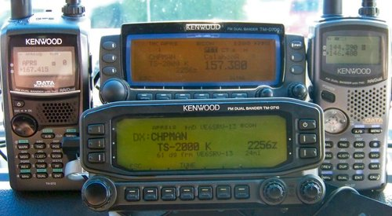</a></td>
<td>The Kenwood line of radios will pop up a screen that alerts the operator to an incoming DX Spot packet. (I missed catching the DX Spot Alerts on the HTs in this image)</td>
</tr>
<tr>
<td><a href="../archive/assets/local--files_kenwood-dx-cluster_Kenwood_DX_List--4140311eeb37.jpg">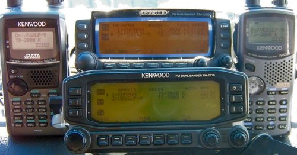</a></td>
<td>

<a href="../archive/assets/local--files_kenwood-dx-cluster_D700_DX_List1--eb9b2a961ef7.png">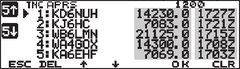</a>

<a href="../archive/assets/local--files_kenwood-dx-cluster_D710_DX_List--33d49ffb8a5f.png">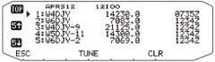</a>

The D700 and D710 radios will show you a list of the packets saved in memory, which you can then choose to investigate further. In the HTs, you can see the first page, and scroll through the packets that way. There is no preview list.

</td>
</tr>
<tr>
<td><a href="../archive/assets/local--files_kenwood-dx-cluster_Kenwood_DX_Detail--23b8bf148d94.jpg">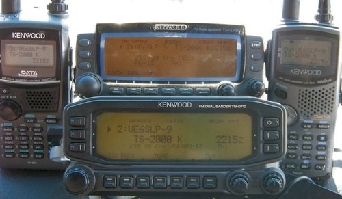</a></td>
<td>

<a href="../archive/assets/local--files_kenwood-dx-cluster_D700_DX_Detail1--2dfa3d6f90ab.png">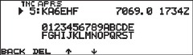</a>

<a href="../archive/assets/local--files_kenwood-dx-cluster_D710_DX_Detail--e75135ce665f.png">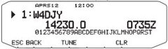</a>

Full decode of the DX Spot packet is shown on a single screen in the mobile radios. In the HTs, some of the DX Spot information can be viewed over two pages

</td>
</tr>
<tr>
<td><a href="../archive/assets/local--files_kenwood-dx-cluster_D7_DX1--ab897b7c7dfc.jpg">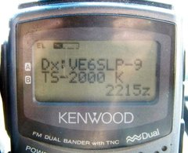</a></td>
<td>

<a href="../archive/assets/local--files_kenwood-dx-cluster_D7_DX_List--b35b0562b404.png">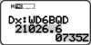</a>

The first page on the D7 shows the spotted callsign, source, and time.

</td>
</tr>
<tr>
<td><a href="../archive/assets/local--files_kenwood-dx-cluster_D7_DX2--98b48fa49718.jpg">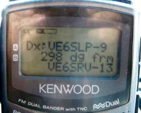</a></td>
<td>

<a href="../archive/assets/local--files_kenwood-dx-cluster_D7_DX_Detail--0688100ecbbc.png">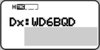</a>

The second page on the D7 shows the spotted callsign and comment text

</td>
</tr>
<tr>
<td><a href="../archive/assets/local--files_kenwood-dx-cluster_D72_DX1--756d5ac7aa72.jpg">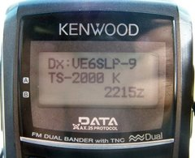</a></td>
<td>

<a href="../archive/assets/local--files_kenwood-dx-cluster_D72_DX_List--1c2f12f72993.png">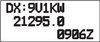</a>

The first page on the D72 shows the spotted callsign, source, and time.

</td>
</tr>
<tr>
<td><a href="../archive/assets/local--files_kenwood-dx-cluster_D72_DX2--39007cb62ce5.jpg">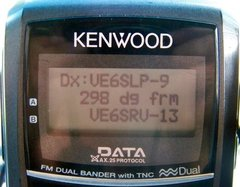</a></td>
<td>

<a href="../archive/assets/local--files_kenwood-dx-cluster_D72_DX_Detail--25ea8e0df207.png">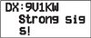</a>

The second page on the D72 shows the spotted callsign and comment text

</td>
</tr>
</table>
