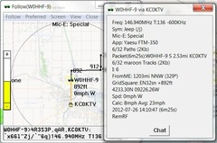
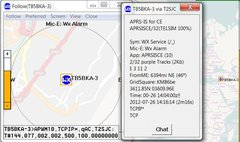
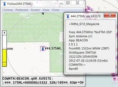
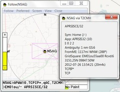
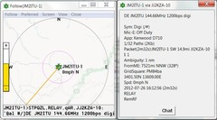

# Map Display

[Source wiki page](https://aprsisce.wikidot.com/map-display) · [Archived HTML](../archive/pages/map-display--a116db0bc309.html) · [Source license](http://creativecommons.org/licenses/by-sa/3.0/)

Main display portion of the screen contains the map display. APRSISCE/32 uses raster map tiles from the [Open Street Map Foundation](http://www.openstreetmap.org/) as the default background map. These maps are built out of raster tiles that are 256 pixels by 256 pixels in size. The tiles required to draw the map are downloaded from the tile server, and stored locally on the storage medium. Tiles are stored locally for a period which is determined by the purge time. This allows the program to not have to download new tiles each time the map is drawn on screen.

Alternate map styles can be configured under the Configure / Map / Tile Sets menu. (See [Tile Sets](tile-sets.md))

The map starts by default at a medium transparency level, which means that map looks somewhat washed out. This allows the APRS information to stand out from the background. The left and right arrow keys will increase and decrease the background transparency respectively. At the far left end of the settings, the map will be completely washed out, with only a white background showing, and the icons may be seen to "jump" in position. This jump is due to a change in the map projection used. The normal map projection used by APRSISCE/32 is a [Mercator Projection](http://en.wikipedia.org/wiki/Mercator_projection) (as is also the default for OpenStreetMaps and many other on-line map providers), while the projection used at the furthest left transparency setting is an [Azimuthal Equidistant Projection](http://en.wikipedia.org/wiki/Azimuthal_equidistant_projection) which shows accurate directions and distances from your location, this is most commonly seen in the Ham community as a beam heading map.

## Range Circle

Overlayed on the map display is a grey circle if you have Configure / Screen / Circle checked. This circle shows the current scale of the map. The distance from the center of the map out to the circle (the radius) is shown in the Range Value box in mile or kilometers depending on Configure / Metric / Distance.

## Icons

As APRS position packets are received from other stations, icons will start appearing on your map. The icon displayed is determined by a code embedded in the packets. The icons are a standard set of pictographs agreed upon by the APRS community. You can not create a custom icon and send that icon to another station via APRS. Icons on your screen may represent the location of another user, or an object sent by another station. If a packet is received that does not contain a valid location, the icon will temporarily be placed at 0,0 off the coast of Africa. Once a valid location packet is received, the station icon will be drawn at the appropriate location. (You will probably find a number of stations bobbing in the ocean due to misconfigured settings if you watch for long enough) As you zoom in and out, the size of the icon will be adjusted, so that you don't have huge icons when zoomed out, allowing more information to be displayed. This can be adjusted under Configure / Screen / Symbol Size

Alongside the icons, you will possibly see a callsign, or name displayed. This will be the assigned callsign (or tactical call) of originating station, or a name assigned to the object. To avoid an extremely cluttered display, once the maximum number of icons on screen is exceeded, the labels are dropped. This can be configured under Configure / Screen / Label / Max Visible…

### Icon Outlines

Some icons will be seen to have an outline around them. This outline can convey a number of different attributes.

|  |  |
| --- | --- |
|  | Mic-E Status atributes are conveyed by a square being drawn around the icon. The colour of the square conveys the attribute information.  * **EMERGENCY!** Msg New Active Flash **Red** * **Priority** Msg New Flash **Orange** * **Alarm** Msg New Flash **Orange** * **Wx Alarm** Msg New Flash **Orange** * **Warning** Msg New **Orange** * **Special** Msg **Yellow** * **Alert** Msg **Yellow** * **Test Alarm** Msg New Active Flash **Crimson** * **unknown** **DarkKhaki** |
|  | WX Alarm active. |
|  | Non-compliant frequency specifications are drawn with a red box around them. |
|  | When only a grid square is known for the station, a box will be drawn around the station showing the grid square on the map with the station shown centered in the grid square. The station may be anywhere within the outlined grid square, but is draw in the center as a convenience. |
|  | A station using position ambiguity will have a circle drawn around the icon. The circle will represent the amount of ambiguity being reported. The station may be anywhere within the stated ambiguity, possibly not even within the circle. The icon is only shown at the center of an appropriately sized ambiguity circle as a convenience. |
