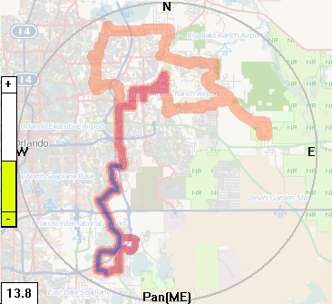

# Overlays

[Source wiki page](https://aprsisce.wikidot.com/menu:configure-overlays) · [Archived HTML](../archive/pages/menu_configure-overlays--424c848a323f.html) · [Source license](http://creativecommons.org/licenses/by-sa/3.0/)

|  |
| --- |
| **Overlays** |

<table class="aprs-figure-table" style="width:100%;margin-right:auto;margin-left:auto;border:1px solid #AAA;">
<tr>
<td style="padding: 10px; text-align: left; background-color: #DDDDEE; border: 1px solid silver; width: 100%;">

<strong>Option: Add GPX File…</strong>

This option allows you to load a GPX file. Simply, click on Add GPX file, find the file of interest it will load.

GPX files can be a bit varied. This can cause interesting results since not every feature of the GPX may be supported. Try it out anyway, you will probably like it!

The scope here is not about GPX, but if you want to learn more about it, check out: <a href="http://www.topografix.com/gpx.asp">GPX: the GPS Exchange Format</a>.

There are many tools that can create a GPX file. It may be a GPS application that can read the tracks, routes and waypoints inside a GPS. Since this is the exchange format, it is almost always a supported input/output. Another tool could be a web application.

No matter how the GPX is created, it can be a very useful tool. There are many waypoint files of potentially interesting items. They could be waterfalls, covered bridges, WX transmitters or maybe even the Bat Cave. The file might contain tracks of places others have been. Content describing a track or route might be the directions to get from here to there. Or, maybe it defines a route/track of an event (e.g., bicycle race to raise awareness/money for Multiple Sclerosis).

Monitoring resources in the course of an event often utilizes APRS. And having the course, waypoints, etc, defined is often quite useful.

Finding a method to convert a road course to a GPX is fairly straight forward, however any method found today may not work in the future.

Before continuing on to options, if it worthy to note that when planning a track it might be worthwhile to plan it in the direction it is to be used. At some point in the future, APRSISCE/32/MO may add arrows showing direction of travel.

This link will help us find a method using Google Maps. The one advantage with using Google tools that work with the Google products is the likeliness they will be around awhile. Google fancies KML and there will likely always be a converter to convert from KML to GPX. 
<a href="http://lmgtfy.com/?q=create+gpx+route+from+google+maps">Let's find an answer!</a> 
<a href="http://gis.stackexchange.com/questions/152571/export-google-maps-route-to-kml-gpx">Hmm, this is a reasonable answer using Google MyMaps.</a>

To export a route to KML you'll have to use <a href="http://www.google.com/mymaps">Google MyMaps</a>.

<ul>
<li>Add a route to new or existing layer.</li>
<li>Drag and drop the route to suit your needs.</li>
<li>Open the maps options menu (3 dots above the layers).</li>
<li>Export to KML.</li>
<li>Remember where you saved your file.</li>
</ul>

You can then use any service to convert the KML to GPX. 
Check out <a href="http://www.gpsies.com/convert.do">GPSies</a>, it seems to work.

Another option recently found is: <a href="http://www.sportrouteplanner.com/index.php">Sport Route Planning</a>.

Using the various options provided, you can produce a route for runners, or cyclists. Once the route is defined, there is a GPX Export option. Just save your route. It is interesting to note that there is an option for route markers but they don't appear to be added to the GPX.

There are no explicit instructions for this option. While the first option included them, the second doesn't because at some point the user <a href="https://en.wiktionary.org/wiki/give_a_man_a_fish_and_you_feed_him_for_a_day;_teach_a_man_to_fish_and_you_feed_him_for_a_lifetime">should learn to fish</a>. Experiment!

Once you have a GPX file saved to your PC:

Load the file into APRSISCE/32. This is accomplished by: 
Toolbar-&gt; Configure -&gt; Overlays -&gt; Add GPX file…

Not only can you see the route, it can be "driven". This may cause APRSISCE/32 to fetch tiles that are local. Repeat at the required zoom levels. Always remember the tile usage requirements!

For events that might have multiple routes, you might want to consider this comment by Lynn.

<blockquote>

"I like to lay down the longest route first with a wide line, then the next shorter as slightly narrower, and so forth until the shortest route is added as the narrowest with. With a good selection of contrasting colors, you can get nice looking overlays as shown below for a recent bicycle event east of Orlando, FL."

</blockquote>

In addition, new waypoints can be made into a transmittable object. Scroll to bottom of this page for more details.

<strong>Option: Add POS File…</strong>

This option allows you to load and enable/disable APRSdata/UI-View-style .POS overlay files.

Note: .POS files MUST BE ASCII and not Unicode! Unicode files will not be loaded by APRSISCE/32.

Overlay files allow you to show information about objects on your map which are not transmitted to other stations, but only displayed locally. But if need be, new positions can be made into a transmittable object. Scroll to bottom of this page for more details.

Enabled files are remembered and re-loaded across client restarts as well. Comments on the position lines are used, but the status lines are not yet supported.

For more information and sample .POS files, read <a href="http://www.ve3kbr.com/aprs/aprs_overlays.htm">VE3KBR's excellent guide</a>.

An example .POS file is (note: the first line is a description, not a position):

* MB7Ux Unattended 24/7 Digis - Created by M0CYP 
MB7UA!5147.85N\00101.84En 
MB7UA&gt;144.800 Point Clear, Essex 
MB7UB!5125.70N\00224.43Wn 
MB7UB&gt;144.800 G4KVI 
MB7UC!5155.31N\00200.63Wn 
MB7UC&gt;144.800 G4GVZ www.g0lgs.myby.co.uk/grg 
MB7UH!5154.53N\00053.93En 
MB7UH&gt;144.800 G6NHU www.mb7uiv.co.uk

And another one:

* APRS (MIC-E) Over Voice Repeater 
MB7IP!5246.08N\00209.56Wn 
MB7IP&gt;144.800 &lt; GB3IP 145.7625 CTCSS 103.5

History:

Overlays were first known to exist in <a href="http://aprs.org/APRS-docs/APRSDATA.TXT">APRSdata</a> where it says:

"APRSdata uses all of the POS\*.POS data files that you already have. To see these in any version of APRSdos, just hit the MAPS-OVERLAYS commands. These POS\*.POS files are distributed with each of the major APRSdos Map distributions."

And here's a link to the <a href="http://www.aprs.net/vm/DOS/OVERLAYS.HTM">original documentation</a> with this priceless client-centric statement:

"Do not worry about exact lat/longs. Just use your eyeball on the most detailed APRS map that you have. The exact location will never matter, since anyone who is viewing the overlay data will be using the SAME map to VIEW it as you did to estimate the position in the first place. "

Plagiarizing the UI-View Manual (UI-VIEW32V203MANUAL.pdf):

The format of an overlay file is very simple. The first line is a description, subsequent lines are location lines or status text lines. Location lines consist of up to nine characters for a callsign/identifier, followed by a '!', followed by a position beacon. Status text lines consist of a callsign/identifier, a '&gt;' , and some status text.

NOTE - UI-View32 overlay files are not fully compatible with APRS overlay files, because APRS doesn't support the status text lines. However, if you create overlay files for UI-View32 and include status text, anyone wanting to use them with APRS can easily remove the status text lines.

And from Chip, VA3KGB:

How to create your own Overlay File

Create the overlay file using an ASCII text editor such as "Notepad". Notepad is great for creating short overlay files but for large files such as creating overlay files for the IRLP Nodes, I have a spreadsheet that reads in the raw data , lets me check for errors in the data manually and then when I'm happy with the raw data, the spreadsheet then creates the files for WinAPRS, UI-View, and xastir for me.

Overlay files are one line per object except for UI-View and APRSISCE/32. With UI-View and APRSISCE/32, you can have a two lines to convey more information.

Included with the overlay files, I also add a text readme file listing the overlay files, explaining where the files need to be located, and any other information that the APRS operator should be aware of before using the file. X-astir users must turn OFF Object/Item transmit before using an overlay otherwise all the objects in the overly get transmitted out over the APRS network!

Format for a one line overlay file for WinAPRS, UI-View, APRSISCE/32

* 144 MHZ IRLP Nodes Callsign overlay for APRS 
* irlp.net node data: 08/12/2008 
* This file created using irlpnodelist-aprs.xls by CJ Chapman, VA3KGB 
VE7RHS!4916.19N/12315.00WnNode 1000,145.270,T100.0 
VE7ISC!4913.64N/12358.45WnNode 1003,146.640(-600) 
VE7VIC!4825.80N/12335.99WnNode 1030,146.840(-600),T100.00 
VE7BYN!5049.52N/11859.48WnNode 1041,147.570 
VE7KJA!5035.03N/12705.61WnNode 1064,146.445

The Asterisk (*) de3notes that this is a comment and is ignored by the APRS program. I usually add comment lines to identify what the overlay file is used for, the date the file was created, and the spreadsheet or source data that was used to generate the file.

Each line is a separate Object.

The format using one line as an example is: 
VE7RHS!4916.19N/12315.00WnNode 1000,145.270,T100.0

Callsign No APRS Message Lat Primary or Alt Icon Table Lon Icon comment 
VE7RHS ! 4916.19N / 12315.00W n Node 1000,145.270,T100.0

The callsign (or identifying label) should be 9 characters or less or it will get truncated.

The (!) tells the system not to send the object out as an APRS message. or is it saying primary or alternate table for the Icon

The Lat is in degrees and decimal minutes format (60°10.92' N 24°31.86' E) stripping out the degree and minute characters and is to 2 decimal places.

In between the Lat and Long is the symbol which identifies which symbol table to use for the icon to be displayed.

The Long is in degrees and decimal minutes format (60°10.92' N 24°31.86' E) stripping out the degree and minute characters and is to 2 decimal places.

The Icon is from APRS Icon tables and uses the alpha/numeric character in conjunction with the Primary/Alt table symbol to identify the graphical icon to display.

The comment field should be kept short, and in this example indicates the IRLP NODE ID, the Frequency and Tone required. Commas (,) are used to separate items within the comment. In the comment field using a spreadsheet to build the overlay files there will be comma with a space between them indicating that the source file had no information for that portion of the comment. If building the file by hand you can delete the space(s) and extra comma(s).

Format for a two line overlay file for UI-View and APRSISCE/32

* 144 MHZ IRLP Nodes Callsigns with Cities overlay for UI-View or APRSISCE/32 
* irlp.net node data: 08/12/2008 
* This file created using irlpnodelist-aprs.xls by CJ Chapman, VA3KGB 
VE7RHS!4916.19N/12315.00WnNode 1000,145.270,T100.0 
VE7RHS&gt; IRLP Node: 1000, Vancouver, BC, Canada 
VE7ISC!4913.64N/12358.45WnNode 1003,146.640(-600) 
VE7ISC&gt; IRLP Node: 1003, Nanaimo, BC, Canada 
VE7VIC!4825.80N/12335.99WnNode 1030,146.840(-600),T100.00 
VE7VIC&gt; IRLP Node: 1030, Victoria, BC, Canada

The format for the first line is as per the one line format above. 
The format for the second line as an example is: 
VE7RHS!4916.19N/12315.00WnNode 1000,145.270,T100.0 
VE7RHS&gt; IRLP Node: 1000, Vancouver, BC, Canada

Callsign Comment-identifier Comment 
VE7RHS &gt; IRLP Node: 1000, Vancouver, BC, Canada

Callsign will be exactly the same as the first line

Comment field again is short and in this example indicated that it is IRLP Node 1000 located in Vancouver BC Canada. (Commas (,) separate the items in the comment. In the comment field using a spreadsheet to build the overlay files there will be comma with a space between them indicating that the source file had no information for that portion of the comment. If building the file by hand you can delete the space(s) and extra comma(s).

<strong>Converting GPX Waypoint and POS data to Objects</strong>

In some cases, the new data is useful as an object. Once a waypoint or position is on the map, it is simple to convert to an object. Find the point on your display and left-click on it. In the dialog window, the last option is MAKE OBJECT. Select it and the <a href="createobject.md">Create Object</a> dialog box opens which will have data from the GPX or POS already loaded for the select point. Perform any editing necessary and ACCEPT. Keep in mind that unique names make your object unique.

</td>
</tr>
</table>

|  |
| --- |
|  |
