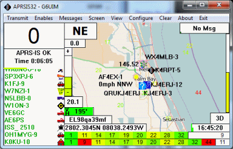

# newstart

[Source wiki page](https://aprsisce.wikidot.com/newstart) · [Archived HTML](../archive/pages/newstart--6b0120b3a977.html) · [Source license](http://creativecommons.org/licenses/by-sa/3.0/)

|  |
| --- |
|  |

|  |  |
| --- | --- |
| **APRSISCE/32** is an advanced Automatic Packet Reporting System (APRS) Client for Amateur Radio, written for Windows and Windows Mobile (CE). It will also run on Linux and Mac OS under WINE, as well as other virtual machines.  APRSISCE/32 can be configured to run connected directly to the APRS-IS via an internet connection, as well as connected to the APRS-RF network via AGWPE, a TNC, or one of the APRS capable Radios including the Kenwood TH-D72/TM-D710 and Yaesu FTM-350.  For a view of the software in use Julian G4ILO's videos are essential viewing [First Use](initial-startup.md) and [port setup](port-configuration.md) |   Click the image for a full screen [view](aprsis-image.md) |

|  |
| --- |
| **FEATURES** |

|  |  |  |  |  |  |  |  |  |  |  |  |  |  |  |  |  |  |  |  |  |  |  |  |  |  |  |  |  |  |  |  |  |  |  |  |  |  |  |
| --- | --- | --- | --- | --- | --- | --- | --- | --- | --- | --- | --- | --- | --- | --- | --- | --- | --- | --- | --- | --- | --- | --- | --- | --- | --- | --- | --- | --- | --- | --- | --- | --- | --- | --- | --- | --- | --- | --- |
| Simple to Setup  |  | | --- | | Only a Callsign is required. To get on Air. To send to the internet a passcode is also required |    APRS-IS  |  | | --- | | Internet Connectivity can be enabled and disabled when required. |    Center on Station  |  | | --- | | Tracking of moving station on map. The map will move to keep the station centred |    Station Display  |  | | --- | | Choose numerous different views of stations and objects. for example view by symbol |    Metric/Imperial  |  | | --- | | Configure for your local unit of distance, altitude and speed etc |    Tracking  |  | | --- | | Path of Travel can be shown on the map. Moving station will leave a track on the map |    Telemetry  |  | | --- | | Access to sending and receiving telemetry data. |    Messaging  |  | | --- | | Very flexible and easy to use Chat system. Can be easily used for messaging via Satellite |    Announcements  |  | | --- | | Flexible monitoring of the ANSRVR System. Used to send and receive to multiple users |    Bulletins  |  | | --- | | Simple to use info broadcast system. Can be used to send local or global information |    Open Source Maps  |  | | --- | | Free configurable detailed and fully scalable map source. Users can edit the maps at the OSM site |    Map Preload/Cache  |  | | --- | | Maps can be stored for use when not online. Download maps from the internet for use while mobile |    AGWPE  |  | | --- | | Use AGWPE single port for very flexible connection to TNCs. |    External TNC  |  | | --- | | Can use many different types of TNCs. Can put the TNC into and out of KISS mode |    NMEA GPS  |  | | --- | | Can use separate GPS and integrated data stream. Can retrieve the NMEA data from a combine NMEA,APRS stream |    APRS Radio  |  | | --- | | Can utilise APRS aware radios. Such as the Kenwood D710 |    Integrated Logging  |  | | --- | | Logging of many features available if required. Most data can be logged to aid debugging |    GeniusBeaconing™  |  | | --- | | Predictive beaconing with error indication. Similar to Smart beaconing | | [Just Call sign and passcode.](start-features.md#simple)  [Internet Connectivity.](start-features.md#aprsis)  [Tracking of station on map.](start-features.md#centre)  [Choose views of stations.](start-features.md#station)  [Configure for your locale.](start-features.md#units)  [Path of Travel shown.](start-features.md#tracking)  [Access to telemetry data.](start-features.md#telemetry)  [Flexible easy to use Chat.](start-features.md#messaging)  [Flexible monitor of ANSRVR.](start-features.md#announcements)  [Simple to use local info system.](start-features.md#bulletins)  [Free fully scalable map source.](start-features.md#osm)  [Maps stored for use offline.](start-features.md#preload)  [Use AGWPE for flexible TNC use.](start-features.md#agwpe)  [Can use many types of TNC's.](start-features.md#etnc)  [GPS or integrated data stream.](start-features.md#nmea)  [Can utilize APRS aware radios.](start-features.md#aprsr)  [Logging of many features.](start-features.md#ilogg)  [Predictive beaconing with errors.](start-features.md#genius) | IGate  |  | | --- | | Configurable Igate for sending and receiving messages, objects. To and from the internet |    Digipeater  |  | | --- | | Flexible Digi setup to meet local needs. Can be configure on an individual path basis |    Update  |  | | --- | | Integrated updates with Internet access. Software downloads are announced and download within the software |    WHO-IS  |  | | --- | | Click to find call details when online. Find contact details of a station |    NWS  |  | | --- | | Mapping of Weather warning areas, for the USA and Australia. |    QRU  |  | | --- | | Set up local objects that can be remotely queried. A built in very advanced object query system |    GeoNames.org  |  | | --- | | access to geocoded addresses for looking up the address of stations and objects |    Direction-Finding  |  | | --- | | plotting of direction finding beams on a map, the beams can be sent to remote stations. |    Multiline Objects  |  | | --- | | Able to send and display complex objects to and from other stations. |    Altitude and Range  |  | | --- | | Set up to monitor for balloons and aircraft with indication of likely simplex coverage. Range circle varies with altitude. |    Transmission path  |  | | --- | | Live plots of transmission paths, Show transmission paths between stations, digipeaters and Igates |    PHG Circles  |  | | --- | | Indication of approximate coverage areas of stations, can transmit your own coverage |    Dead-Reckoning  |  | | --- | | Prediction of current location of moving stations. Based on last known speed and direction |    GeoCaching.com  |  | | --- | | Load geocaches on your map. To enable use while geocaching |    Weather  |  | | --- | | Current observations are available. From those sending weather information |    Connectivity  |  | | --- | | Configurable to use with USB, Bluetooth, serial and TCPIP connectivity. |    Map Transparency  |  | | --- | | Adjustable map intensity display for high object contrast. | | [Configure for messages, objects.](start-features.md#igate)  [Very flexible Digipeater setup.](start-features.md#digi)  [Auto update check (Internet).](start-features.md#update)  [Find call details when online.](start-features.md#whois)  [Shows WX alert areas, US and Oz.](start-features.md#nws)  [Objects can be remotely queried.](start-features.md#qru)  [Access to geocoded addresses.](start-features.md#geoname)  [Mapping of beams, send to others.](start-features.md#direction)  [Send and display complex objects.](start-features.md#multi)  [Flights with RF Range Circles.](start-features.md#altitude)  [Live plots of transmission paths.](start-features.md#transmit)  [Shows aprox coverage areas.](start-features.md#phg)  [Predicts track of moving stations.](start-features.md#dead)  [Load geocaches on your map.](start-features.md#geoc)  [Current observations are available.](start-features.md#wx)  [USB, Bluetooth and TCPIP.](start-features.md#connect)  [Adjustable map intensity display.](start-features.md#mapt) |

|  |
| --- |
| **Overview of APRSISCE/32** |

|  |
| --- |
| APRSISCE/32 is a sophisticated Automatic Packet Reporting System (APRS) client, which unlike many other clients aims to accurately implement the entire APRS specification. And make allowances for those clients that do not.  The software also includes many advanced features, as alluded to in the feature list above.  APRSISCE/32 is under active development, and the development version is regularly updated and also freely available, New users are encouraged to use the general release version until they are familiar with the software.  The wiki is reasonably comprehensive and users are advise to use it to find out about the software via the site navigation [Link](menu-tree.md). Although the wiki is being constantly updated, for support and for requesting features you would like added, please join the [Groups.io Support Group](https://groups.io/g/APRSISCE) if you are an new user you may need a [Passcode](doc-passcode.md). |

|  |  |  |
| --- | --- | --- |
| [Open embedded content](../reference/newstart-html-de1d2cebba08988b542a98b9b55745ed6f937078-794897369855639851.md) | [Open embedded content](../reference/code-blocks-code-2.md) | [Open embedded content](../reference/newstart-html-e5b4211cd5e53aed44ca1db75b9d75bd5636e7b2-1737424848354838815.md) |

|  |
| --- |
| ©Homeside Software Inc **KJ4ERJ** 2009-2011. [APRS](http://www.aprs.org)®is a registered trademark of Bob Bruninga, **WB4APR**. Map data ©[OpenStreetMap](http://www.openstreetmap.org) contributors, CC-BY-SA |
