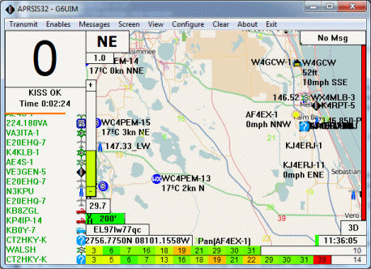
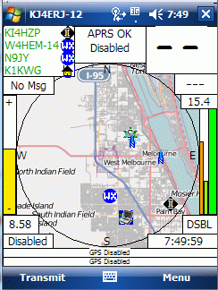

# Newstart1

[Source wiki page](https://aprsisce.wikidot.com/newstart1) · [Archived HTML](../archive/pages/newstart1--f36f58732d4f.html) · [Source license](http://creativecommons.org/licenses/by-sa/3.0/)

|  |  |
| --- | --- |
|  |  |
| **APRSISCE/32** is an Automatic Packet Reporting System (APRS) Client for Amateur Radio, written for Windows and Windows Mobile (CE). It will also run on Linux and Mac OS under WINE, as well as other virtual machines. **APRSISCE/32** can be configured to run connected directly to the APRS-IS via an internet connection, as well as connected to the APRS-RF network via AGWPE, a TNC, or one of the APRS capable Radios including the Kenwood TH-D72/TM-D710 and Yaesu FTM-350. | |
| FEATURES | |
| **APRS-IS**  **IGate**  **Digipeater**  **Messaging**  **Bulletins**  **WHO-IS**  **Open Source Maps**  **Map Preload/Caching**  **Tracking**  **Dead-Reckoning**  **Weather**  **NWS** | **Direction-Finding**  **Telemetry**  **Center on Station**  **GeoNames.org**  **GeoCaching.com**  **Metric/Imperial**  **External TNC**  **NMEA GPS**  **ANSRVR**  **QRU**  **AGWPE**  **APRS Radio** |

©Homeside Software, Inc. **KJ4ERJ** 2009 - 2011. [APRS](http://www.aprs.org)® is a registered trademark of Bob Bruninga, **WB4APR**. Map data © [OpenStreetMap](http://www.openstreetmap.org) contributors, CC-BY-SA
