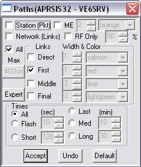

# Paths

[Source wiki page](https://aprsisce.wikidot.com/paths) · [Archived HTML](../archive/pages/paths--432bf968fda9.html) · [Source license](http://creativecommons.org/licenses/by-sa/3.0/)

|  |
| --- |
|  |

Paths allows one to visualize the path that packets being handled by the RF network.

The **Screen|Paths|Appearance…** link will open a dialog box that allows selection of a number of different criteria, as well as customization of a number of parameters.  
The Station (Pkt) check box toggles…  
The ME check box toggles…  
The Network (Links) check box toggles the display of lines showing the path taken by a packet to get to the station receiving the packet. The paths shown can be filtered on a number of criteria:

* RF Only : Only packets heard via RF are plotted and packets heard via the Internet are not shown
* All : Overrides all of the following check boxes.
  + Direct : Packets heard from the source with no hops used (source to final).
  + First : Packets originating at the source, but heard by another station (source to digi).
  + Middle : Packets being passed from one station to another (digi to digi).
  + Final : Packets being received via an intermediate station (digi to final)

> Final is either the RF station that heard the packet or the IGate contained in the APRS-IS packet.
