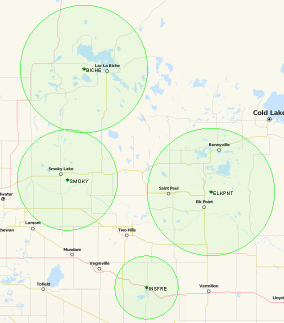

# PHG

[Source wiki page](https://aprsisce.wikidot.com/phg) · [Archived HTML](../archive/pages/phg--d38e6666b4de.html) · [Source license](http://creativecommons.org/licenses/by-sa/3.0/)

|  |
| --- |
| **PHG** |

<table class="aprs-figure-table" style="width:100%;margin-right:auto;margin-left:auto;border:1px solid #AAA;">
<tr>
<td style="padding: 10px; text-align: left; background-color: #DDDDEE; border: 1px solid silver; width: 100%;">

The APRS specification includes a definition that is used to approximate the radio range of a station. The information available in the PHG specification includes:

P - Radio transmitter power level 
H - Height of the antenna (Note, not absolute altitude, but height above average terrain) 
G - Gain of the antenna used 
D - Directivity (favoured direction, whether due to antenna pattern, or terrain effects)

You'll probably immediately note that there's a fourth character at the end for directivity. That has always been part of the specification, but never gets mentioned in the abbreviation.

<h3 id="toc0">PHG codes deciphered</h3>
<table class="wiki-content-table">
<tr>
<th>phgd Code:</th>
<th>0</th>
<th>1</th>
<th>2</th>
<th>3</th>
<th>4</th>
<th>5</th>
<th>6</th>
<th>7</th>
<th>8</th>
<th>9</th>
<th>Units</th>
</tr>
<tr>
<td><strong>Power</strong></td>
<td>0</td>
<td>1</td>
<td>4</td>
<td>9</td>
<td>16</td>
<td>25</td>
<td>36</td>
<td>49</td>
<td>64</td>
<td>81</td>
<td><strong>watts</strong></td>
</tr>
<tr>
<td><strong>Height</strong></td>
<td>10</td>
<td>20</td>
<td>40</td>
<td>80</td>
<td>160</td>
<td>320</td>
<td>640</td>
<td>1280</td>
<td>2560</td>
<td>5120</td>
<td><strong>feet</strong></td>
</tr>
<tr>
<td><strong>Gain</strong></td>
<td>0</td>
<td>1</td>
<td>2</td>
<td>3</td>
<td>4</td>
<td>5</td>
<td>6</td>
<td>7</td>
<td>8</td>
<td>9</td>
<td><strong>dB</strong></td>
</tr>
<tr>
<td><strong>Directivity</strong></td>
<td>omni</td>
<td>45</td>
<td>90</td>
<td>135</td>
<td>180</td>
<td>225</td>
<td>270</td>
<td>315</td>
<td>360</td>
<td></td>
<td><strong>degrees</strong></td>
</tr>
</table>

Choose the power value that is the closest to your operating power level. It's always better to go one step lower than too much higher than what you are using for power.

The height value in PHG is the most often improperly reported value as many people mistakenly think they should be reporting their altitude. For ground based radio work, absolute height above sea level means absolutely nothing. The more important value is how much higher are you than the rest of the terrain around you. At VHF, that relative height is the biggest factor in determining how far your signal travels. If you are on top of a 500 foot hill in the middle of a flat plain, you're going to be heard over a much larger area than if you were just sitting on perfectly flat land. Calculating <a href="http://en.wikipedia.org/wiki/Height_above_average_terrain">HAAT</a> (height above average terrain) means taking a sample of the heights of the terrain around your station at specified intervals, adding it all together, and then dividing that by the number of samples used. This will give you the average height of the terrain in your area. If you are on that hilltop, you'll end up with a positive HAAT figure. If you live in a valley surrounded by mountains, you might end up with a negative HAAT value.

The gain of the antenna will modify the range of the station. Choose the gain closest to the gain figure for your antenna.

Directivity can be a factor of the pattern of radiation from your antenna, or it can be used to show a favourable direction due to hills blocking your signal. Directivity offsets the pattern drawn by a factor of 3 to 1. You're not going to see a sharp directional pattern emerging, but rather a cardioid pattern is used to show the favoured direction.

Once you have your PHG(D) numbers figured out, have a look on the map to see how the covered area matches your reception area. If it's too generous, or maybe a little short, fiddle with the values until it closely approximates the area you can hear. It's better to fudge the numbers a bit and have a fairly accurate coverage area, than to try and get precise numbers, but show an unrealistic coverage area.

<h3 id="toc1">HAAT tools</h3>

There are some tools available that can help with calculating your HAAT. <a href="http://www.cplus.org/rmw/english1.html">RadioMobile by Roger Coudé VE2DBE</a> includes a HAAT calculator. There are also online HAAT calculators available as well at <a href="http://transition.fcc.gov/mb/audio/bickel/haat_calculator.html">http://transition.fcc.gov/mb/audio/bickel/haat_calculator.html</a>

The height code can be any character 0-9 and above, which allows for reporting larger heights such as aircraft, balloons, and satellites.

<h3 id="toc2">There's more?</h3>

There are also addenda than extend the PHG(D) specification to include R (Rate) which indicates the number of probes sent per hour for use with a <a href="http://www.apritch.myby.co.uk/traffic.htm">UI-View add-on</a> that can determine the health of the APRS network by keeping track of the number of probes heard from a specific station versus the number sent from the originating station. 
Also Aloha circles <a href="http://www.aprs.org/aloha/ALOHAcir.txt" target="_blank">Link</a>

<h3 id="toc3">Clearing PHG from aprs.fi</h3>

aprs.fi remembers status/comments information over a longer period as the status/comment messages can change as the user rotates through different status/comments. If you no longer are beaconing PHG data, aprs.fi will usually still show the last one that you DID beacon. To clear this, set your PHG to PHG0000 and beacon a few times. aprs.fi treats this nonsensical report as a special trigger to clear historical PHG information from the station in question.

</td>
</tr>
</table>

|  |
| --- |
|  |
