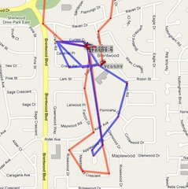
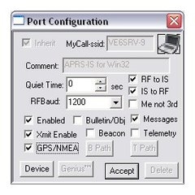

# Kenwood TM-D710 Port (APRS mode)

The Kenwood TM-D710 has the ability to push all of the APRS packets heard out the COM port (Menu 604 set to ON) that is found on the back of the control head when it is running in full APRS mode (Use TNC button to set to APRS).

APRSISCE/32 supports this mode by being able to parse the data being presented out the COM port during normal APRS operations, and displaying the information on the computer screen. By default, APRSISCE/32 still attempts to assume full control of the TM-D710 radio. It is possible to configure APRSISCE/32 in APRS mode to remain a passive component of the complete package. This allows the Kenwood TM-D710 to still be the component in control of the APRS operations, while APRSISCE/32 becomes the supplementary display, augmenting the APRS information available to the user.

The Kenwood TM-D710 is designed as a nearly fully self-contained APRS station, with the ability to perform most of the common APRS functions built right in. With a mapping GPS unit attached, one is able to not only send live position updates, but also have incoming positions from other stations displayed on the GPS as well. Weather station information as well as messages can be displayed on the TM-D710 screen.

Messaging can be initiated from the TM-D710 using the DTMF keyboard in a manner similar to texting on a cellular phone, but there are many who find this to be a less than desirable input method.

By having APRSISCE/32 monitoring the COM port, it is possible to decode and display all of the information received by the TM-D710. Everything that you can see on the TM-D710 display, as well as positions plotted on the attached GPS display can be seen on the APRSISCE/32 instance. In addition, you will be able to decode and display packets that the TM-D710 does not have the ability to decode/display. Packets such as DF reports, multiline objects, as well as recording tracks left by stations as they travel about and others can be visualized on the APRSISCE/32 display.

So why not just run in KISS mode, and let APRSISCE/32 take full control of the TM-D710? In KISS mode, APRSISCE/32 has no access to the GPS unit attached to the TM-D710. You'll either need to supply another GPS unit feeding the APRSISCE/32 instance, or disconnect the GPS from the TM-D710, and connect it into the device running APRSISCE/32. APRSISCE/32 does not have the facility for providing APRS waypoints to the GPS either, so the ability to have APRS icons displayed on the GPS, and subsequent functions such as navigating to the APRS POIs on the GPS are no longer available. The TM-D710 can also be configured to display the information received in packet on screen automatically. This is a function also not supported by APRSISCE/32.

By having the Kenwood TM-D710 running in native mode, you get all of the functionality available in the TM-D710, augmented by the abilities of APRSISCE/32. You lose nothing, and gain a great deal of added functionality through the use of the combination of these devices.

When in APRS mode, all of the packets received by the TM-D710 are passed along to the APRSISCE/32 instance for processing. Also included are the GPS positioning strings from the attached GPS unit (Menu ??? set to ??? and KWD710(APRS) port in APRSISCE/32 has "GPS/NMEA" checked). This simplifies the interconnection of the TM-D710 to the APRSISCE/32 instance, with a simple single serial connection between the devices. This can be accomplished with a simple serial cable connection, or a wireless solution as well.

The trick comes in when APRSISCE/32 wants to have access to the TNC in order to send packets outbound through the radio. The COM port was designed to be a monitoring port only, allowing a program such as APRSISCE/32 to listen to what the radio was hearing. However, there are a number of commands that can be accessed via the COM port which allow access to the internals of the control head and TNC.

APRSISCE/32 makes use of these internal commands (TC 0, TC 1) in order to assume control of the radio so it can send packets. In doing so, APRSISCE/32 sends a number of commands to the radio, including a command to set the source callsign (MYCALL). If the TM-D710 is left in control, and APRSISCE/32 is attempting to assert control, you can end up with some interesting effects. Note that APRSISCE/32 cannot provide digipeater support in this mode because the UNPROTO … VIA … command does not support used (\*) path components.

The basic tenet espoused is that every APRS instance running should have it's own unique callsign-ssid. When running in APRS mode, it is possible to have position packets being sent by both the TM-D710, as well as APRSISCE/32. This can create what appears to be many more position packets than desired. You can also end up with a situation where the TM-D710 may be sending position packets, only to have the APRSISCE/32 instance take over, and vice-versa. When attempting to follow such a station, it can become difficult to keep track of where they have been… The image to the right shows a track that started off being created by the Kenwood TM-D710 as VE6SRV, but partway around Meadowood Crescent, APRSISCE/32 took over command, and changed the callsign to VE6SRV-9.

An interesting side effect of this phenomenon is that the APRS software running in the TM-D710 control head is not aware of the callsign change in the TNC, and upon hearing it's own packets being digipeated, the TM-D710 will display the packets on screen as if they were originated from a different station, and will also pass the packet waypoints to the attached GPS. This mode of operation incidentally is a mode desired by a number of APRS operators, which is usually expressed as the "Why can't I see my own packets?", or "How can I tell where I am?" queries on various message boards. It does work on as a handy way of knowing when your packets are being digipeated, and received back by your station.

How can you configure APRSISCE/32 to run in APRS mode without usurping control from the Kenwood TM-D710 radio? Well, you really can't if you expect APRSISCE/32 to ever transmit because on the first transmission, MYCALL will be set which changes the D710's identity until it's next TNC reset. However, if you avoid messaging from APRSISCE/32 (or even receiving a message to which an ack must be sent), the following might work for you.

Start by creating a new port, selecting KWD710(APRS), and the appropriate COM port for your hardware. Once you have the hardware configuration selected, you'll end up with the Port Configuration screen as seen to the left. There are a number of check boxes on the screen that allow you to customize the packet types being sent on that port by APRSISCE/32.

* **RF to IS** allows packets heard on this RF port to be passed to the APRS-IS stream. (i-gating to the internet)
* **IS to RF** Probably unchecked to avoid transmissions - allows packets heard on the APRS-IS to be passed to the RF network for stations heard locally. (i-gating to RF)
* **Me not 3rd** Doesn't work due to UNPROTO/VIA restrictions - keeps packets from your own station using other SSIDs from being passed as third party traffic when gated from IS to RF
* **Enabled** Checked - Enables communications on this port
* **Bulletins/Obj** Unchecked - Allows APRSISCE/32 to transmit bulletins and/or objects on this port
* **Messages** Checked - If you want messaging to work on APRSISCE/32 (See warning above)
* **Xmit Enable** Unchecked if you want to NEVER assume control of the radio, Checked if you expect even message acking to work from APRSISCE/32
* **Beacon** Unchecked - You're relying on the D710 to be beaconing
* **Telemetry** - Unchecked
* **GPS/NMEA** - Checked - To allow APRSISCE/32 to pick up passthrough NMEA data from the D710-connected GPS

Temporary link for D72 info: <http://wiki.complete.org/THD72PCAPRS>  
Llink for D74 info: [Kenwood TH-D74](thd74.md)
