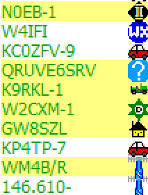

# Scroller

[Source wiki page](https://aprsisce.wikidot.com/scroller) · [Archived HTML](../archive/pages/scroller--65277e530c57.html) · [Source license](http://creativecommons.org/licenses/by-sa/3.0/)

|  |
| --- |
| **Scroller** |

|  |
| --- |
|   The scrolling packet window shows packets for stations (or objects) that were recently received. This window communicates many things about the packet as follows:  **Callsign-SSID** - The assigned station callsign, or tactical station identifier  **\*** - An asterisk after the callsign indicates that the packet was received from RF (AGW, KISS or TEXT ports)  **#** - A pound sign after the callsign indicates that the packet was received from RF inside a 3rd party packet  **@** - An at sign after the callsign indicates that the packet was digipeated by your station  **n** - If there's a number after the asterisk, it counts how many times the packet was received (total of IS and RF digipeats)  **(n)** - If there's a number in parenthesis in the callsign, it indicates that multiple copies of the packet were received via APRS-IS  **Symbol** - current station symbol including all spec-specified assumptions based on:  1) Explicit statement in packet  2) Weather data is a weather symbol  3) GPSxxx specification in ToCall (Page 92/103 of aprs101.pdf)  4) Assumption based on -SSID value (Page 93/103 of aprs101.pdf)  5) APRSISCE/32 also uses ~ for Telemetry data if no other symbol was previously known  A box is drawn around the symbol if the packet was received direct (no paths used) via RF.  Clicking on an entry in the scrolling list will bring up that station's popup menu as well as present the packet for that entry across the bottom of the map.  **Note** If the scrolling region gets a red border when you click it, it is frozen for review. Left click anywhere BUT on the scroller (or right click on the scroller) to unfreeze the list and allow new entries to be displayed.  **Note Also**: The contents and behavior of the Packet scroller are controlled by [Configure / Scroller Menu](menu-configure-scroller.md) options so YMMV.   ---  Text Color **Black** : No position known for the station  **Red**- **Yellow**- **Green** - Scaled color based on proximity (Red = close, Green = far)  The scale of this conversion is the circle on the map. If the station is within the circle, the color will vary from Green (outer edge) to Red (dead center) based on how close the station is to the coordinates at the center of the screen.  **Reversed** **Red**- **Yellow**- **Green** - Scaled as above, but reverse video for callsigns that seem to be in your extra filter as a "buddy" (b/) or "friend" (f/). This may get some false positives until I add explicit Buddy and Friend filter configuration. Background Color **"Invalid"** - See details in the upcoming "Invalids" trace log  **Purple** - Duplicate packet  **Pink** - Too Quick packet (sub second)  **Red** - Too Fast packet (>20,000mph or double rolling average)  **Aqua** - "Restart" packet (long story, under development)  **Gray** - Unknown Invalid (should never be seen)  **Yellow** - Other APRSISCE/32 users have a yellow background unless something else overrides the color (like buddy). |

|  |
| --- |
|  |
