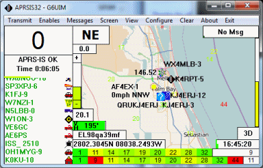

# Welcome to APRSISCE/32

[Source wiki page](https://aprsisce.wikidot.com/start) · [Archived HTML](../archive/pages/start--9b9f794c3d0d.html) · [Source license](http://creativecommons.org/licenses/by-sa/3.0/)

|  |
| --- |
|  |

<table class="aprs-figure-table" style="width:100%;margin-right:auto;margin-left:auto;border:1px solid #AAA;">
<tr>
<td style="padding: 10px; text-align: left; background-color: #DDDDEE; border: 1px solid silver; width: 70%;">

<strong>APRSISCE/32</strong> is an advanced Automatic Packet Reporting System (APRS) Client for Amateur Radio, written for Windows (x86 and x64) and Windows Mobile (CE). It will also run on Linux and Mac OS under WINE, as well as other virtual machines. It does *NOT* run on any <a href="cevswinmo.md">Windows CE 5 or 6</a> GPS unit as of 2012/04/11.

APRSISCE/32 can be configured to run connected directly to the APRS-IS via an internet connection, as well as connected to the APRS-RF network via software modems such as UZ7HO Sound Modem, Dire Wolf or AGWPE, using a TNC, or one of the APRS capable Radios including the Kenwood TH-D72/TM-D710 and Yaesu FTM-350.

For a view of the software in use Julian G4ILO's videos are essential viewing <a href="initial-startup.md">First Use</a> and <a href="port-configuration.md">port setup</a>. And if you're trying to set up for an event in the near future, please read <a href="what-am-i-missing.md">this</a>. If you're looking for presentation materials, please check <a href="presentations.md">here</a>

<a href="../reference/code-blocks-code-2.md">Open embedded content</a>

</td>
<td style="padding: 10px; text-align: center; background-color: #DDEEDD; border: 1px solid silver;width: 30%;"> 
Click the image or <a href="aprsis-image.md">here</a> for a full screen view</td>
</tr>
</table>

|  |
| --- |
| **FEATURES** |

|  |  |
| --- | --- |
| **SIMPLE to USE**  Get online just Call sign and passcode required.  **APRS-IS**  Internet Connectivity selectable when required.  **Center on Station**  Tracking of moving station on map.  **Station display**  Choose different views of stations and objects.  **Metric/Imperial**  Configure for your local arrangements  **Tracking**  Path of Travel can be shown on the map.  **Telemetry**  Access to telemetry data  **Messaging**  Very flexible easy to use Chat system.  **Announcements**  Flexible monitor of ANSRVR System  **Bulletins**  Simple to use local info broadcast system.  **Open Source Maps**  Free configurable detailed fully scalable map source  **Map Preload/Caching**  Maps can be stored for use when not online.  **AGWPE**  Use AGWPE port for flexible connection to TNC's.  **External TNC**  Can use many different types of TNC's  **NMEA GPS**  Can use separate GPS and integrated data stream.  **APRS Radio**  Can utilize APRS aware radios.  **Integrated Logging**  Logging of many features available if required.  **GeniusBeaconing™**  Predictive beaconing with error indication. | **IGate**  Configurable Igate for messages, objects.  **Digipeater**  Flexible Digi setup to meet local needs  **Update**  Integrated updates with Internet access.  **WHO-IS**  Click to find call details when online.  **NWS**  Mapping of Wx warning areas, US and Oz.  **QRU**  Set up local objects that can be remotely queried.  **GeoNames.org**  Access to geocoded addresses  **Direction-Finding**  Mapping of beams, can be sent to remote stations.  **Multiline Objects**  Send and display complex objects to other stations.  **Altitude and Range**  Monitor for balloons and aircraft with RF Range Circle.  **Transmission path**  Live plots of transmission paths  **PHG Circles**  Indication of approximate coverage areas.  **Dead-Reckoning**  Prediction of current location of moving stations.  **GeoCaching.com**  Load geocaches on your map.  **Weather**  Current observations are available  **Modern Connectivity**  Use with USB, Bluetooth and TCPIP connectivity.  **Map Transparency**  Adjustable map intensity display for high object contrast. |

|  |
| --- |
| **Overview of APRSISCE/32** |

|  |
| --- |
| APRSISCE/32 is a sophisticated Automatic Packet Reporting System (APRS) client, which unlike many other clients aims to accurately implement the entire APRS specification. And make allowances for those clients that do not.  The software also includes many advanced features, as alluded to in the feature list above.  APRSISCE/32 is under active development, and the development version is regularly updated and also freely available, New users are encouraged to use the general release version until they are familiar with the software.  The wiki is reasonably comprehensive and users are advise to use it to find out about the software via the site navigation [Link](menu-tree.md). Although the wiki is being constantly updated, for support and for requesting features you would like added, please join the [Groups.io Support Group](https://groups.io/g/APRSISCE) if you are a new user you may need a [Passcode](doc-passcode.md). |

|  |  |  |
| --- | --- | --- |
| [Open embedded content](../reference/start-html-de1d2cebba08988b542a98b9b55745ed6f937078-3625708972113266360.md) | [Open embedded content](../reference/code-blocks-code-2.md) | [Open embedded content](../reference/start-html-e5b4211cd5e53aed44ca1db75b9d75bd5636e7b2-2104043504166918509.md) |
