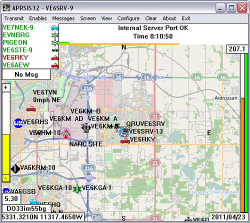
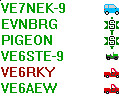

# tempmain

The APRSISCE/32 main screen contains a great deal of information.

Menubar  

Standard Windows menubar containing a list of selectable menu item.

Scrolling Station List  

List of the last stations heard.

Messages  
Zoom Control  
Scale  
Gridsquare  
Lat/Long  
Map Status  
Date/Time  
Battery  
Station Stats  
Odometer  
Satellites
