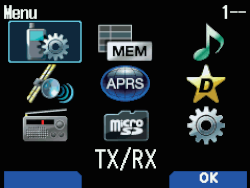
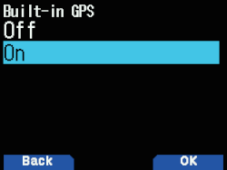
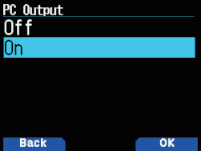
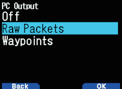
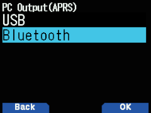

# Kenwood TH-D74

## Kenwood TH-D74 Bluetooth Configuration

To configure your Kenwood TH-D74 for connection to a device running APRSICE/32 via bluetooth, you will need to access the menu in the radio, and configure a number of settings as follows:

Access Menu No. 400 Built-In GPS  
Select [On]

Access Menu No. 405 PC Output  
Select [On]

Access Menu No. 580 PC Output  
Select [Raw Packets]

Access Menu No. 930 Bluetooth  
Select [On]

Access Menu No. 981 PC Output (GPS)  
Select [Bluetooth]

Access Menu No. 982 PC Output (APRS)  
Select [Bluetooth]

Access Menu No. 983 KISS  
Select [Bluetooth]

In APRSIS32, on the port I have the following settings checked/filled out:  
RF to IS  
Enabled  
Bulletin/Obj  
Messages  
Telemetry  
GPS/NMEA
