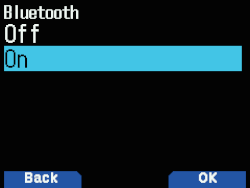
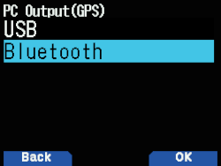
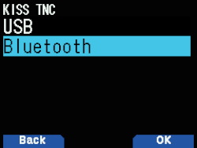

# Kenwood TH-D74

[Source wiki page](https://aprsisce.wikidot.com/thd74) · [Archived HTML](../archive/pages/thd74--2330afd7c7b8.html) · [Source license](http://creativecommons.org/licenses/by-sa/3.0/)

|  |
| --- |
| **Kenwood TH-D74 Bluetooth Configuration** |

<table class="aprs-figure-table" style="width:100%;margin-right:auto;margin-left:auto;border:1px solid #AAA;">
<tr>
<td style="padding: 10px; text-align: left; background-color: #DDDDEE; border: 1px solid silver; width: 70%;">

To configure your Kenwood TH-D74 for connection to a device running APRSICE/32 via bluetooth, you will need to access the menu in the radio, and configure a number of settings as follows:

</td>
<td style="padding: 10px; text-align: center; background-color: #DDEEDD; border: 1px solid silver;width: 30%;">

</td>
</tr>
<tr>
<td style="padding: 10px; text-align: left; background-color: #DDDDEE; border: 1px solid silver; width: 70%;">Access Menu No. 400 Built-In GPS 
Select [On]</td>
<td style="padding: 10px; text-align: center; background-color: #DDEEDD; border: 1px solid silver;width: 30%;">

</td>
</tr>
<tr>
<td style="padding: 10px; text-align: left; background-color: #DDDDEE; border: 1px solid silver; width: 70%;">Access Menu No. 405 PC Output 
Select [On]</td>
<td style="padding: 10px; text-align: center; background-color: #DDEEDD; border: 1px solid silver;width: 30%;">

</td>
</tr>
<tr>
<td style="padding: 10px; text-align: left; background-color: #DDDDEE; border: 1px solid silver; width: 70%;">Access Menu No. 580 PC Output 
Select [Raw Packets]</td>
<td style="padding: 10px; text-align: center; background-color: #DDEEDD; border: 1px solid silver;width: 30%;">

</td>
</tr>
<tr>
<td style="padding: 10px; text-align: left; background-color: #DDDDEE; border: 1px solid silver; width: 70%;">Access Menu No. 930 Bluetooth 
Select [On]</td>
<td style="padding: 10px; text-align: center; background-color: #DDEEDD; border: 1px solid silver;width: 30%;">

</td>
</tr>
<tr>
<td style="padding: 10px; text-align: left; background-color: #DDDDEE; border: 1px solid silver; width: 70%;">Access Menu No. 981 PC Output (GPS) 
Select [Bluetooth]</td>
<td style="padding: 10px; text-align: center; background-color: #DDEEDD; border: 1px solid silver;width: 30%;">

</td>
</tr>
<tr>
<td style="padding: 10px; text-align: left; background-color: #DDDDEE; border: 1px solid silver; width: 70%;">Access Menu No. 982 PC Output (APRS) 
Select [Bluetooth]</td>
<td style="padding: 10px; text-align: center; background-color: #DDEEDD; border: 1px solid silver;width: 30%;">

</td>
</tr>
<tr>
<td style="padding: 10px; text-align: left; background-color: #DDDDEE; border: 1px solid silver; width: 70%;">Access Menu No. 983 KISS 
Select [Bluetooth]</td>
<td style="padding: 10px; text-align: center; background-color: #DDEEDD; border: 1px solid silver;width: 30%;">

</td>
</tr>
</table>

In APRSIS32, on the port I have the following settings checked/filled out:  
RF to IS  
Enabled  
Bulletin/Obj  
Messages  
Telemetry  
GPS/NMEA
