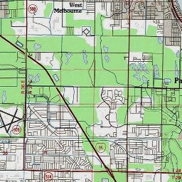
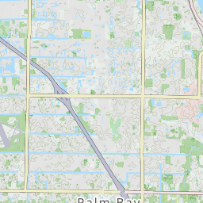
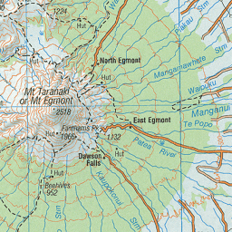
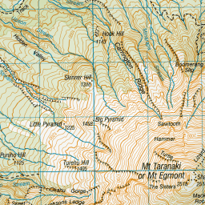

# Tile Sets

APRSISCE/32 uses the [OpenStreetMap](http://www.openstreetmap.org) tile set as a default background map. These map tiles are part of an Open Source mapping project which has the intention of creating a freely distributable non-encumbered map of the world for use in all kinds of projects, such as APRSISCE/32. Most of the map sources normally encountered have copyright or other use restrictions.

## Map Tiles

The OSM maps are delivered as 256 X 256 pixel tiles that APRSISCE/32 downloads from the server, and keeps in a cache on the local storage medium. These tiles are drawn on screen to produce the maps that are used to plot stations on. The tiles are purged from the cache after a preset time to keep the local storage from being filled. It is possible to change the purge time to have the tiles available for as long as desired, including disabling the purge time to allow the tiles to remain forever.

## Default Server

The default tile set "Original" is the Mapnik style used as the default at the [OpenStreetMap](http://www.openstreetmap.org) website. There are a number of different tilesets available for use with APRSISCE/32. They all use the same map database, but use different rendering styles which may highlight different features, or just use different color sets that may be more desirable to the end user.

<table class="wiki-content-table aprs-figure-table">
<tr>
<td></td>
<td></td>
</tr>
<tr>
<td>Original (Mapnik)</td>
<td>ArcGIS US Topo</td>
</tr>
<tr>
<td></td>
<td></td>
</tr>
<tr>
<td>CycleMap</td>
<td>MapQuest</td>
</tr>
</table>

Okay, there is one above that is not generated from OpenStreetMap data. That would be the ArcGIS tile. It does show that other tiles outside of the OSM series may be used. With a bit of exploration, others can be found.

## Configure Tile Sets

To configure APRSISCE/32 to use alternate tile sets, you will need to select Configure | Map | Tile Sets | New Tile Set

A configuration dialog box will open up where you can enter the information require to set up your new tile set.

*Note: Whatever Tile Set configuration you last Accepted becomes the default tile set for all new windows and across APRSISCE/32 restarts. The default tile set is indicated by the checkmark in the Configure | Map | Tile Sets menu (MapQuest Aerial in the screen-shot above).*

*Name* is the name you want to use for the tile set.  
*Server* is the base URL for the server that will be providing the map tiles.  
*80* is the port number used to access the tiles.  
*URL* is the directory qualifier to point to the location of the tiles on the server  
*status* check here if the server supports tile change status updates  
*Purge Enabled* check here to have tiles purged from your file storage medium  
*Retain* sets the number of days to keep tiles before being deleted  
*Zoom Min Retain Max* configures the minimum and maximum zoom levels to be retained even if the global tile purger is configured to delete tiles.

### Note: When you click Accept, APRSISCE/32 will ask you to locate a directory in which to store the tiles. This must be a new, empty directory for this tile set! If you put multiple tile sets into a single directory, you'll get a mish-mash of both tile sets!

### Available tile servers (only a subset - there are quite a few)

| Source | Name | Server | URL |
| --- | --- | --- | --- |
| Open Cycle Map | CycleMap | b.tile.opencyclemap.org | [/cycle/](http://b.tile.opencyclemap.org/cycle/13/2260/3431.png) |
| TopOSM | MassTopo (Only MA) | tile2.toposm.com | [/ma/final/](http://tile1.toposm.com/ma/final/14/4869/6040.png) |
| MapQuest | Street | otile3.mqcdn.com | [/tiles/1.0.0/osm/](http://otile3.mqcdn.com/tiles/1.0.0/osm/13/2260/3431.png) |
| MapQuest | Aerial | otile1.mqcdn.com | [/tiles/1.0.0/sat/](http://otile1.mqcdn.com/tiles/1.0.0/sat/13/2260/3431.png) |
| ArcGIS | USA Topo Maps | services.arcgisonline.com | [/ArcGIS/rest/services/USA\_Topo\_Maps/MapServer/tile/%z/%y/%x.jpg](http://services.arcgisonline.com/ArcGIS/rest/services/USA_Topo_Maps/MapServer/tile/14/6013/4952.jpg) |
| ArcGIS | World Topo Maps | services.arcgisonline.com | /ArcGIS/rest/services/World\_Topo\_Map/MapServer/tile/%z/%y/%x.jpg |
| ArcGIS | World Imagery | services.arcgisonline.com | /ArcGIS/rest/services/World\_Imagery/MapServer/tile/%z/%y/%x |
| ArcGIS | World Street Map | services.arcgisonline.com | /ArcGIS/rest/services/World\_Street\_Map/MapServer/tile/%z/%y/%x.jpg |
| ArcGIS | National Geographic Map | services.arcgisonline.com | /ArcGIS/rest/services/NatGeo\_World\_Map/MapServer/tile/%z/%y/%x.png |
| ArcGIS | World Navigation Charts | services.arcgisonline.com | /ArcGIS/rest/services/Specialty/World\_Navigation\_Charts/MapServer/tile/%z/%y/%x.jpg |
| CalTopo | US Topo | s3-us-west-1.amazonaws.com | [/caltopo/topo/%z/%x/%y.png?v=1](http://s3-us-west-1.amazonaws.com/caltopo/topo/14/4952/6013.png) |
| CalTopo | 1900 US Topo | s3-us-west-1.amazonaws.com | /ctfun/1900/%z/%x/%y.png |
| CalTopo | 1930 US Topo | s3-us-west-1.amazonaws.com | /ctfun/1930/%z/%x/%y.png |
| CalTopo | USFS | s3-us-west-1.amazonaws.com | /ctusfs/pbs/%z/%x/%y.png |
| CalTopo | Visitor | s3-us-west-1.amazonaws.com | /ctfun/visitor/ |
| CalTopo | Canadian Matrix | s3-us-west-1.amazonaws.com | /nrcan/canmatrix/%z/%x/%y.png?v=1 |

*Be aware that some of the above servers only support limited geographic areas, and may not cover your area, or may only support limited zoom levels.*

Above are some tile sets that have been predetermined. Rather than include every tile set that exist, some education is reasonable to expect from users that wish to use an alternate set. By closely examining the examples below, many more tile sets may be found and utilized.

Now, there are more tile servers available that can be used. Using the original tile paradigm, they just need to fit the pattern that is used by the tile fetching algorithm where the URL used to fetch the tiles is as such:

b.tile.opencyclemap.org/cycle/$z/$x/$y.png

Where b.tile.opencyclemap.org is the server, /cycle/ is the "URL", and the desired tile is designated by elements; z, x and y.

* zoom ($z)
* horizontal ($x)
* vertical ($y)

Entering elements, z = 9, x = 141 and y = 214, will produce a Server/URL:  
[http://b.tile.opencyclemap.org/cycle/9/141/214.png](../archive/assets/cycle_9_141_214--a4e065abdb5b.png)

The tile returned will be:

### New Tile Paradigm

The new tile paradigm has added more options. The original format still works. However, if the server has the requirement of re-ordered tile elements, z, y and x, or y, x and x, or an inverted y element is necessary, then more information needs to be added to the URL.

Specifically, the tile elements z, x and y need to be added with the correct formatting. The proper format is %z, %x and %y (or %!y for inverted y). **Note: The server may need to be in a specific order.** The tile extension for anything other than PNG will be needed as well. Current extension options are, JPG and PNG.

An example of a server that requires an inverted y is:  
Server: earthncseamless.s3.amazonaws.com

The URL will demonstrate the use of an inverted-y element:  
URL: /%z/%x/%!y.png

Inverted-Y = (2z-1)-y

If we want a tile from z=9, x=141 and y=214, then y must be inverted. Y becomes 297. The link to the tile becomes:  
<http://earthncseamless.s3.amazonaws.com/9/141/297.png>

The tile result is:  

For more information on the earthnc.com server, please check:  
<http://earthnc.com/online-nautical-charts>

The aeronautical and nautical tiles above were found by experimenting with URLs. During general surfing, new maps may be found. By examining the "behind the scenes" data, sometimes a useful link to a tile can be found. One such method for exploring behind the scenes data:  
Firefox: Toolbar > tools > Page Info > Media.

Suppose while examining some "behind the scenes" data, a link like this is found:  
server.arcgisonline.com/ArcGIS/rest/services/World\_Topo\_Map/MapServer/tile/15/12104/9922.jpg

How would this be used? Some experimentation is in order. First, a simple copy and paste into a browser address bar will produce this:

Determining which element is z, x and y has to be done. Z is pretty easy. The X and Y are not always easy. Figuring this out tends to be bit trial and error. The simplest method is to navigate to the same location with APRSIS32 and check the current tile in the center by double clicking. By comparing the elements in the link above and the return in APRSIS32, it is simple to determine what each element is. In the example above, x and y are simply re-ordered.

The Server and URL still must be determined. The server starts at the beginning and continues up to the first stroke [/]. In this example:  
Server: server.arcgisonline.com

The URL is the rest of the line, starting with the stroke. Each element will be replaced by its placeholder and in the same order as in the link. The result becomes:  
URL: /ArcGIS/rest/services/World\_Topo\_Map/MapServer/tile/%z/%y/%x.jpg

And by the way, that is also an example of the X and Y in reversed positions.

Notice the .jpg at the end of the URL. The tiles from the ArcGIS server are not png as required in the past. This must be included at the end of the URL.

In the event two elements match but the third is "wrong". It is probably using the Invert-Y. As in the nautical tile example above, use the %!y and try it.

Looking around at the various servers may be enlightening. X and y may be depicted as i and j or maybe as "x=" and "y=". A little experimenting will often result in a new tile. At minimum, a bit of an education may be acquired.

One user has used 25-30 different sets, and the count continues, each with varying degrees of usefulness. Just how useful is a set of 1812 World Map Tiles to APRS anyway? Yet, they are available for an explorer. And, he just added the sets below. He enjoys surfing maps the world over.

For **New Zealand** users there is an option for you!

Recognize this location?

<table class="wiki-content-table aprs-figure-table">
<tr>
<td></td>
<td></td>
</tr>
</table>

The following links produce the tiles above:  
[http://nz1.nztopomaps.com/11/2014/780.png](../archive/assets/11_2014_780--da31fef88663.png)  
[http://nz1.nztopomaps.com/13/8056/3122.png](../archive/assets/13_8056_3122--6f952caf9a20.png)

These are the settings for the tile set:  
Server: nz1.nztopomaps.com  
URL: /%z-%x-%!y.png  
Zoom Min 5, Zoom Max 15

From **Germany, Switerland, Austria and Italian Alps Region?**  
These are a bit strange but maybe usable. I think the world must be gone beyond the borders. :)

Server: s0.outdooractive.com  
URL: /map/AlpsteinSummer/  
Zoom Min 0, Zoom Max 17

And:  
Server: s0.outdooractive.com  
URL: /map/AlpsteinCHESummer/  
Zoom Min 0, Zoom Max 17

### GoogleMaps / YahooMaps

While GoogleMaps, YahooMaps and a number of other online mapping services serve up map tiles in a manner similar to OpenStreetMap, they have restrictive licenses that do not allow unencumbered access to the map tiles, as well as offline tile caching and usage restrictions. Due to these limitations, APRSISCE/32 does not attempt to make use of the tiles from these sources.
