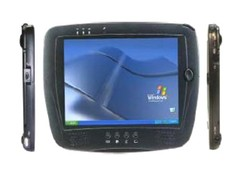
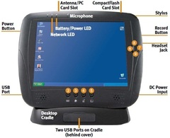
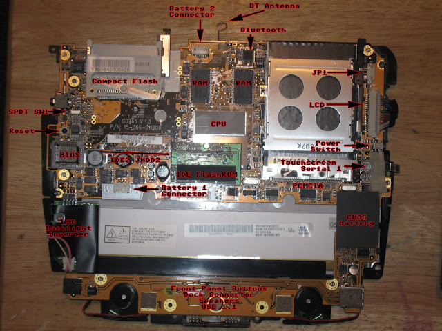

# WebDT 366

The WebDT 366 is a Windows CE tablet that has a version of APRSISCE built specifically for this platform.

The WebDT 366 boasts a number of features:

* 8.4" Display w/Resistive Touch - 800X600 SVGA
* AMD Geode GX, 366mhz
* 500mb Flash Memory
* 256mb RAM
* 802.11b WIFI
* USB
* CF SLOT
* Currently running Windows CE Pro Plus 5
* Capable of running Windows XP Lite or Linux
* Int. Flash Module Storage
* PCMCIA
* Mini PCI

All of this combined makes the WebDT 366 an attractive device to use with your APRS station.

## Software Installation

The APRSISCE build for the WebDT 366 is available from the [Downloads](downloads.md) page. It is a zip file, which can be unzipped and written to a Compact Flash card. This flash card can be inserted into the CF slot found on the top right side of the tablet.

It is also possible to download a copy of the program directly to the device using the built in web browser. If you download the zip file, you will also need to download an unzip program to run on Windows CE.

You could also optionally unzip the file and transfer the unzipped file to the device using a fileshare or hosted service.

## Memory Management

On the stock unit you will find two directories FlashStorage and FlashStorage2. By default, the APRSISCE.xml file ends up in FlashStorage2, while the APRSISCE log files end up in My Documents.

The Compact Flash card inserted into the CF slot will appear as Storage Card in the file directories.

One common modification done to these units is to increase the size of the internal Flash Drive (FlashStorage and FlashStorage2???) by replacing the stock unit with a larger drive. A thread about changing the Flash Drive out can be found at [this link](http://webdt.org/forum/viewtopic.php?f=16&t=517)

## Shortcut Keys

There are 10 assignable keys on the WebDT 366. The power key, while technically assignable is not capable of being reassigned with the stock Windows CE software. The left most key below the screen is the keyboard shortcut, and it too is not reassignable, although it is in the button assignment selection list. The 4 way rocker pad to the right of the display screen is listed as 4 separate keys. The last assignable key is on the right hand side of the unit.

These keys can be assigned different functions using the Buttons application in the Control Panel. You can select the desired button, and then assign a specific function to the button. Most of the assignable functions are internal commands, or built in applications. You can assign individual key presses that are available in the selection window, but these are limited to up, down, left, and right. It is also possible to assign a key to launch a user defined program, with parameters to a button.

It is unknown if it is possible to assign user defined keypresses to buttons as of yet.

## What's inside that thing?

Interested in knowing what's inside that little case but too chicken to pull the screws? Here's a sneak peek inside the unit with some labels to identify the innards!

## Notes

* USB memory sticks also work to transfer data into the device
* Prolific 2303 being the only serial port adapter for which the WebDT 366 has drivers.
